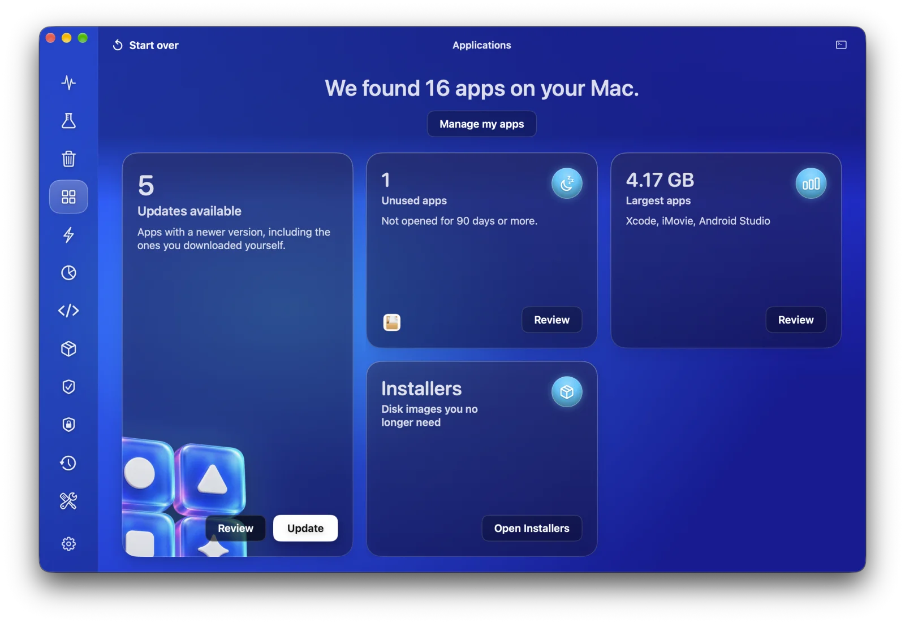
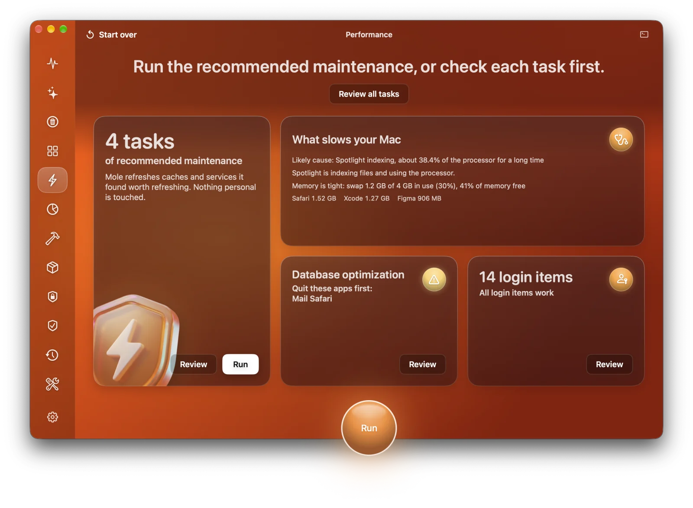
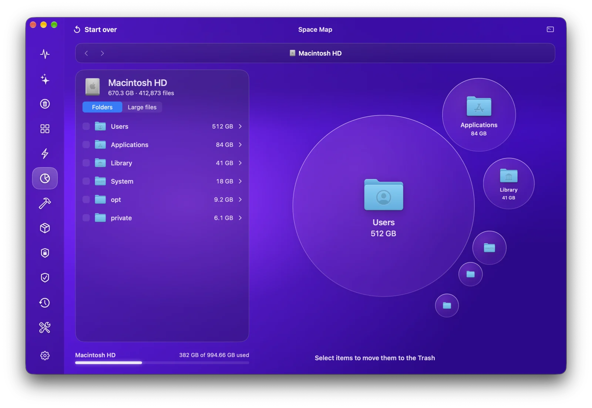
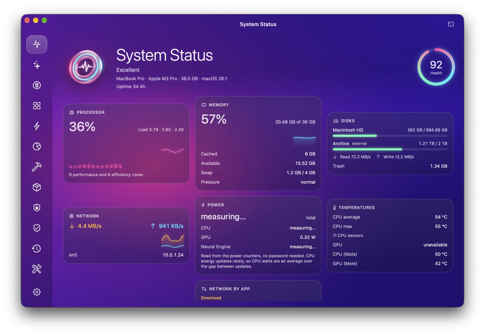
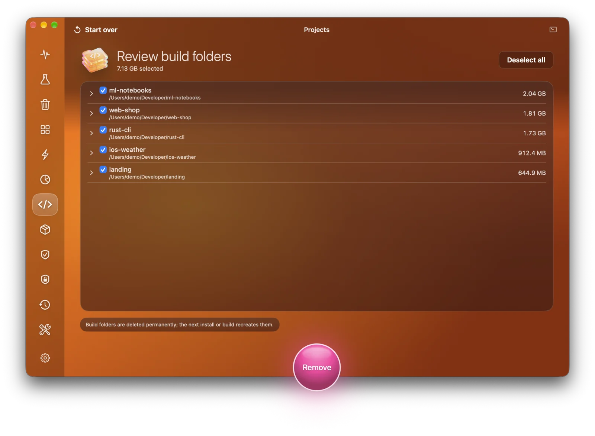
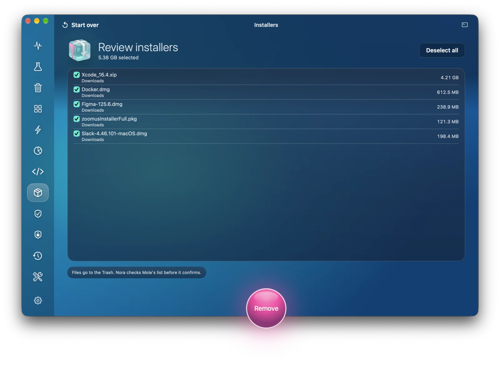
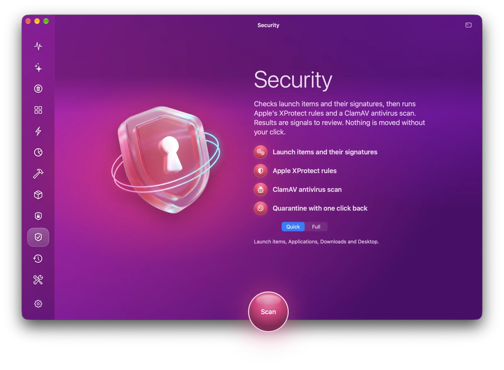
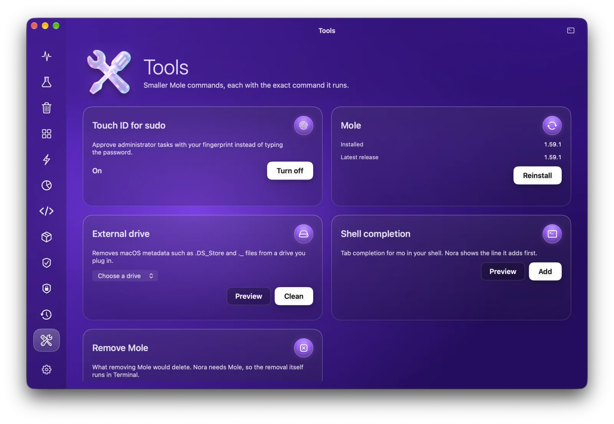

  

<h1 align="center">Nora</h1>

  <b>A native macOS app for the <a href="https://github.com/tw93/Mole">Mole</a> command-line tool.</b> 
  Clean your Mac, remove apps with their leftovers, speed it up, see what fills your disk, watch system health live and scan for malware. All from one glass window and your menu bar.

  <b>English</b> · <a href="README.uk.md">Українська</a> · <a href="README.ru.md">Русский</a>

  
  
  
  

  <a href="https://github.com/Lexus2016/Nora/releases/latest"><b>⬇ Download Nora for macOS</b></a>

## Why Nora

[Mole](https://github.com/tw93/Mole) is a free, open-source toolkit that does what CleanMyMac, AppCleaner, DaisyDisk and iStat Menus do, but you run it in Terminal. Nora gives Mole a native Mac window and keeps everything it does in plain sight.

- **Nothing is deleted before you review it.** Every module works the same way: Scan, Review, Done. You see each item and its size first.
- **Checkboxes that mean something.** An unticked item is really kept: Nora protects it for that run and checks Mole's own confirmation screen against your choice before it agrees. If anything does not match, Nora cancels and nothing is removed.
- **Nothing hidden.** The console (<kbd>⌘J</kbd>) shows every command Nora ran and Mole's full output. You can also show the exact command under each action in Settings.
- **Antivirus built in.** ClamAV and Apple's own XProtect rules check your apps, downloads and launch items. One click installs ClamAV, and Nora updates its virus database every day while it runs.
- **Installs Mole for you.** No Terminal needed. Nora uses Homebrew if you have it, otherwise Mole's official installer with a pinned version and a verified checksum. No admin password.
- **Menu bar quick menu.** Health, four stats of your choice, what loads your Mac most, space to free and quick jumps to every section (<kbd>⌥⌘N</kbd>).
- **Native and light.** SwiftUI and AppKit, a universal app for Apple silicon and Intel. Nora runs the Mole you have and does not bundle its own engine.
- **Multilingual.** Nora speaks your Mac's language when it knows it and falls back to English otherwise. More languages are on the way.

## Features

| Module | What it does | Under the hood |
|---|---|---|
| **Smart Care** | One scan for junk, maintenance, build folders and installers. *Run* does every ticked task in turn | `mo clean`, `mo optimize`, `mo purge`, `mo installer` (previews first) |
| **Cleanup** | Caches, logs and leftovers by category. Untick anything to keep it. System caches are optional and ask for your password or Touch ID | `mo clean` with a temporary protection list |
| **Applications** | Remove an app with its helpers, caches and settings (to the Trash or permanently), update Homebrew apps, find apps you no longer open and the largest ones | `mo uninstall`, `brew` |
| **Performance** | What slows your Mac right now, and 20 maintenance tasks (DNS, Spotlight, Finder caches, databases, network) | `mo optimize` |
| **Space Map** | Folders as a bubble map and a list, large files, drill down and move anything to the Trash | `mo analyze --json` |
| **System Status** | Health score, processor, memory, disks, network, power and temperatures, energy mode, traffic by app, listening ports, battery, Bluetooth | `mo status --watch`, system counters |
| **Projects** | `node_modules`, `target`, `build`, `.venv` and more, grouped by project. Recently active projects stay untouched | `mo purge` |
| **Installers** | Forgotten DMG, PKG, ZIP and similar files in Downloads, iCloud, Mail and Telegram, moved to the Trash | `mo installer` |
| **History** | Space freed, sessions and a daily chart | `mo history --json` |
| **Protection** | What Mole must never touch: cleanup rules, maintenance tasks, project folders | `~/.config/mole/*` |
| **Security** | Launch items and their signatures, Apple's XProtect rules and a ClamAV antivirus scan. Findings are explained and never preselected. Quarantine with one click back, optional scheduled scans | Security.framework, `yara`, ClamAV |
| **Tools** | Touch ID for sudo, cleanup of external drives, Mole updates, shell completion | `mo touchid`, `mo clean --external`, `mo update` |

## Antivirus and security

The **Security** module checks your Mac in three ways and shows what it finds as signals to review. Nothing is moved until you click.

| Check | What it looks at |
|---|---|
| **Launch items** | Every program that starts on its own: your launch agents, system agents and daemons. Nora flags a missing or unsigned program, a broken signature, a program in a temporary, shared or hidden folder, and arguments that pipe a download into a shell, decode base64 or run AppleScript |
| **Apple XProtect rules** | The malware rules that macOS itself ships, run with `yara` over the files you scan |
| **ClamAV** | The open-source antivirus engine and its database of known malware |

- **What gets scanned.** *Quick* covers launch items, Applications, Downloads and Desktop. *Full* covers your whole home folder, except iCloud folders.
- **Setup in one click.** ClamAV is not bundled. *Install ClamAV with Homebrew* installs it together with `yara` and downloads the virus database right away: about 57 MB for the program and 110 MB for the database. Without Homebrew, Nora links to brew.sh.
- **Always up to date.** While Nora runs, in the window or in the menu bar, it updates the virus database once a day. Before a manual scan it updates a database older than a day. If that fails, the scan still runs and Nora shows the date of the database it used.
- **When something is found.** Each finding says why it was flagged, and none is ticked for you. *Quarantine* moves the file into Nora's own folder, unloading a launch agent first, and *Restore* puts it back. Deleting from quarantine asks you to confirm.
- **Optional, in Settings → Security.** A scheduled scan, daily or weekly, that notifies you when it finds something. *Watch Downloads* checks new files in Downloads as they arrive; it keeps ClamAV's database in memory (about 1 GB, up to 2.4 GB during the daily reload), so it is off by default.
- **What Nora does not promise.** This is not real-time protection: ClamAV can watch every file access only on Linux. Nora works alongside macOS's own XProtect and Gatekeeper and does not replace them.

## Screenshots

| | |
|---|---|
|  |  |
| **Smart Care:** one scan for everything | **Menu bar:** live stats and quick jumps |
|  |  |
| **Cleanup:** junk by category, review before cleaning | **Applications:** updates, unused and largest apps |
|  |  |
| **Performance:** what slows your Mac and what to run | **Space Map:** what fills your disk |
|  |  |
| **System Status:** live, every second | **Projects:** build folders by project |
|  |  |
| **Installers:** forgotten disk images | **History:** what Mole has done |
|  |  |
| **Security:** signals to review, nothing moved without your click | **Tools:** smaller Mole commands |

The screenshots use demo data.

## Install

1. Download `Nora-1.0.0.dmg` from the [latest release](https://github.com/Lexus2016/Nora/releases/latest).
2. Open it and drag **Nora** to **Applications**.
3. Start Nora. If Mole is missing, Nora installs it for you.

- macOS 14 Sonoma or later, Apple silicon or Intel.
- The app is signed with a Developer ID and notarized by Apple, so it opens without warnings.
- Nora keeps itself up to date with Sparkle and keeps Mole up to date from Tools.
- Full Disk Access is recommended, so that Mail, Safari and the Trash can be scanned. Nora shows where to turn it on.

To build Nora yourself, see [docs/BUILD.md](docs/BUILD.md).

## How to use it

1. Pick a section in the left rail. **Smart Care** is the quickest start.
2. Press **Scan**. Nothing is deleted at this step: Nora runs Mole's preview.
3. Review the list. Untick anything you want to keep, or keep it for good in **Protection**.
4. Press the round button to run. Nora asks for your password only when system areas are included, then shows what was done. **Show log** opens Mole's full output.

## Safety

- Nora never deletes on its own. Removal always follows a review and your click.
- Caches, logs and build folders are deleted permanently, as Mole does; Mole checks every path again first. Apps and installers go to the Trash. Deleting an app permanently asks once more.
- When Nora edits Mole's protection list, Mole's own default protections and safety rules stay in place.
- Your password goes straight to `sudo` through the system dialog or Touch ID. Nora never sees or stores it.
- No telemetry. Nora goes online only to check for updates (Nora and Mole), to install Mole, and to update the ClamAV database if you installed ClamAV.

Known limits, because Mole works this way: Mole removes build folders by rescanning rather than from a list, so a folder created in the seconds before removal is not protected; and installers are matched by name, folder and size, as Mole's menu shows no full path.

## Documentation

- **Design and architecture:** [English](docs/en/DESIGN.md) · [Українська](docs/uk/DESIGN.md) · [Русский](docs/ru/DESIGN.md)
- **Building and releasing:** [docs/BUILD.md](docs/BUILD.md)
- **Early design concept:** the [interactive browser prototype](https://lexus2016.github.io/Nora/prototype/) that the app grew from

## Roadmap

- [x] Research, design and interactive prototype
- [x] Mole driver: pseudo-terminal sessions, protection overlay with crash recovery, `sudo` in the same session ([MoleKit](MoleKit))
- [x] Every Mole module, Smart Care, menu bar, onboarding, multilingual interface
- [x] Security: launch items, XProtect rules, ClamAV, quarantine, scheduled scans
- [x] 1.0: signed and notarized DMG, Sparkle updates
- [ ] A read-only MCP server for AI agents
- [ ] More languages

## Credits and trademarks

- **Mole** is created by [tw93](https://github.com/tw93) and licensed under GPL-3.0. *Mole* and the Mole logo are trademarks of the Mole project. Nora is an **independent** project. It is not affiliated with or endorsed by Mole, and it is not the official [Mole for Mac](https://mole.fit) app.
- **ClamAV** is developed by [Cisco Talos](https://www.clamav.net) and licensed under GPL-2.0. ClamAV is a registered trademark of Cisco Systems, Inc. Nora does not bundle ClamAV: it runs the copy you install with Homebrew as a separate program. Nora is not affiliated with or endorsed by Cisco.
- **[YARA](https://virustotal.github.io/yara/)** by VirusTotal (BSD-3-Clause) runs Apple's **XProtect** rules, which Nora reads from macOS. XProtect, Gatekeeper and macOS are trademarks of Apple Inc.
- **[Sparkle](https://sparkle-project.org)** (MIT) delivers Nora's updates. **[Homebrew](https://brew.sh)** (BSD-2-Clause) installs Mole, ClamAV and `yara`.
- Design and research references: [MangelSP/MoleUI](https://github.com/MangelSP/MoleUI), [Zhili1004/MoleUI](https://github.com/Zhili1004/MoleUI), [gokuscraper/mole-gui](https://github.com/gokuscraper/mole-gui), [caezium/Burrow](https://github.com/caezium/Burrow), [exelban/stats](https://github.com/exelban/stats) and others listed in the design document.

## License

[PolyForm Noncommercial 1.0.0](LICENSE) © 2026 Lexus2016

You may use, copy, modify and share Nora's code for any noncommercial purpose: personal use, study, research and hobby projects, and use by charities, schools and public institutions. Commercial use needs a separate license from the author. Open an issue to ask.

Mole is a separate GPL-3.0 project. Nora runs it as an external program and does not include its code, so Mole's license is unaffected.
