

  

<h1 align="center">Nora</h1>

  <b>A native macOS app for the <a href="https://github.com/tw93/Mole">Mole</a> command-line tool.</b> 
  Deep clean, uninstall apps, speed up your Mac, see what fills your disk, and watch system health live. All from one neon-glass window and your menu bar.

  <b>English</b> · <a href="README.uk.md">Українська</a> · <a href="README.ru.md">Русский</a>

  
  
  
  

  <a href="https://lexus2016.github.io/Nora/prototype/"><b>▶ Try the interactive prototype</b></a>

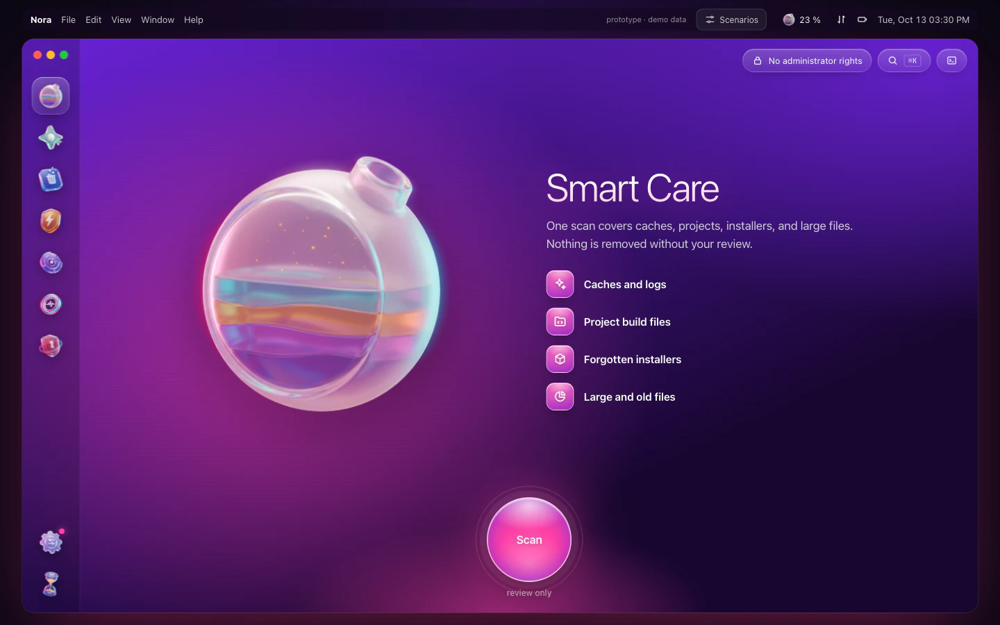

> [!NOTE]
> **Project status.** The design and the interactive prototype are approved. The native SwiftUI app is in development. Signed DMG builds will be published on the [Releases](https://github.com/Lexus2016/Nora/releases) page. Watch the repo to get notified.
>
> The prototype follows your Mac's language: English, Ukrainian or Russian. Any other language gets English. The screenshots are in English.

## Why Nora

[Mole](https://github.com/tw93/Mole) is a free, open-source toolkit. You run it from the Terminal app, and it combines what CleanMyMac, AppCleaner, DaisyDisk and iStat Menus do. Nora gives Mole a native Mac window. It does not hide what happens underneath.

- **Review before anything is deleted.** Every module follows the same steps: Scan, Review, Done. You see each path and its size before Mole touches it.
- **Honest checkboxes.** A checkbox appears only when Nora can make Mole respect it. Unchecked cache items are protected by a temporary protected list in Mole (Mole calls it a whitelist), which Nora restores afterwards. Nora answers prompts in Mole's interactive menus only after it has checked the on-screen list against your selection. There are no cosmetic checkboxes.
- **Nothing hidden.** Every action shows the exact `mo …` command. A built-in console shows Mole's live output.
- **Installs and updates Mole for you.** One click, no Terminal. Nora uses Homebrew (a package manager) if you have it. Otherwise it runs Mole's official installer, with a pinned version and a verified checksum (a fingerprint that proves the file is intact). The tool goes into `~/.local/bin`, and no admin password is needed. Nora also keeps itself up to date, using Sparkle 2 and a signed update feed.
- **Menu bar quick menu.** Live health, CPU, memory, network, disk, GPU, fan, battery, top processes and space you can free up. One click jumps to any section.
- **Native and light.** Nora is built with SwiftUI and AppKit, Apple's tools for Mac apps. It runs the Mole you already have and does not bundle its own engine.
- **Your language, automatically.** English, Ukrainian or Russian, picked from your macOS language. Any other system language falls back to English. There is no language switch.

## Features

| Module | What it does | Under the hood |
|---|---|---|
| **Smart Care** | One review-only scan across caches, project build files, installers and large files. Then one safe *Run* | `mo clean --dry-run`, `mo purge --dry-run`, `mo installer --dry-run`, `mo analyze --json` |
| **Cleanup** | Caches, logs, leftovers of removed apps, Trash, optional system caches (Touch ID / password) | `mo clean` + whitelist overlay, `sudo -A` in the same PTY session |
| **Applications** | Remove apps with LaunchAgents, caches and preferences. Personal data is kept by default. Move to Trash or delete permanently | `mo uninstall --list` (JSON), `mo uninstall [--permanent] "App"` |
| **Performance** | 20 limited maintenance tasks (DNS, Spotlight, Finder caches, databases, network…), each one can be switched on or off | `mo optimize`, `~/.config/mole/whitelist_optimize` |
| **Space Map** | Rings and treemap views, drill-down, insights (old downloads, iOS backups, Xcode/Docker data), large files, external drives | `mo analyze --json PATH` |
| **System Status** | Health score, per-core CPU, memory pressure, disk I/O, network, battery, thermals, Bluetooth, processes, CPU alerts | `mo status --watch --interval 1s` (NDJSON) |
| **Projects** | `node_modules`, `target`, `build`, `.venv`… grouped by project. Recently active projects stay untouched | `mo purge [--yes]` |
| **Installers** | Forgotten DMG / PKG / ISO / XIP / ZIP files in Downloads, iCloud, Mail, Telegram, Homebrew | `mo installer` |
| **History** | Activity dashboard: space freed, sessions, recommendations, the full operations log | `mo history --json` |
| **Protection** | What Mole must never touch: cache rules, custom paths, maintenance exclusions, project scan roots | `~/.config/mole/*` |
| **Tools** | Touch ID for sudo, external-drive metadata cleanup, Mole update, shell completion, Raycast / Alfred, read-only MCP for AI agents | `mo touchid`, `mo clean --external`, `mo update` |
| **Security** *(planned)* | Malware scan on demand: login-item and LaunchAgent audit, code-signing and notarization checks, Apple's local XProtect YARA rules, the ClamAV engine (installed on request). Findings are explained and never pre-selected. Quarantine supports restore | Security.framework, `yara`, `clamd` / `freshclam` |

## Screenshots

| | |
|---|---|
| 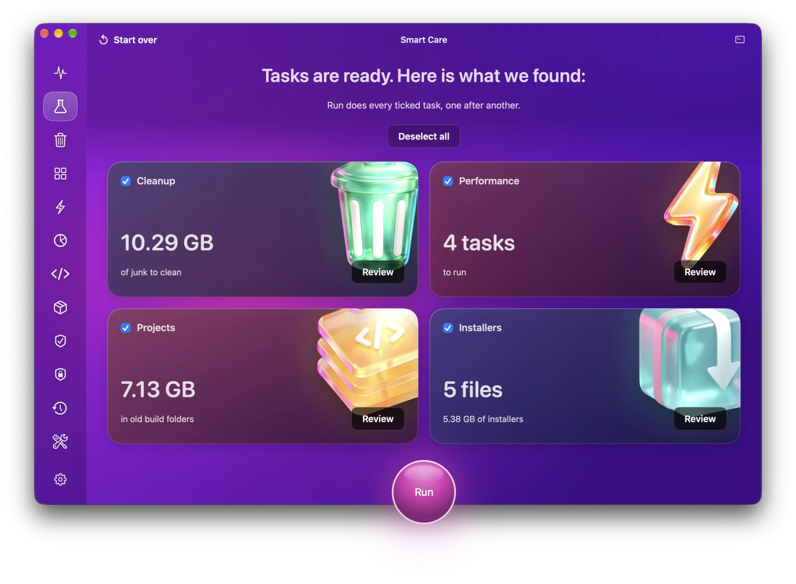 | 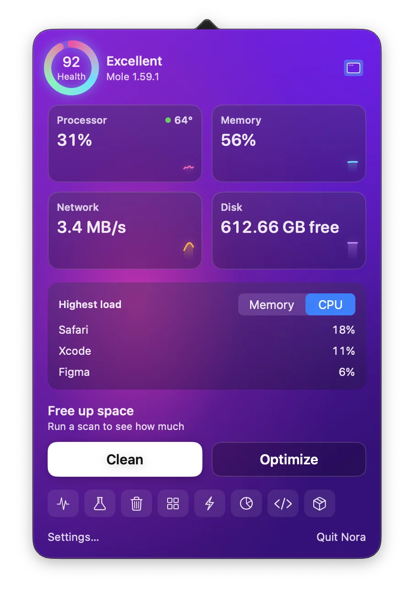 |
| **Smart Care:** everything you can free up, at a glance | **Menu bar:** live stats and quick jumps |
| 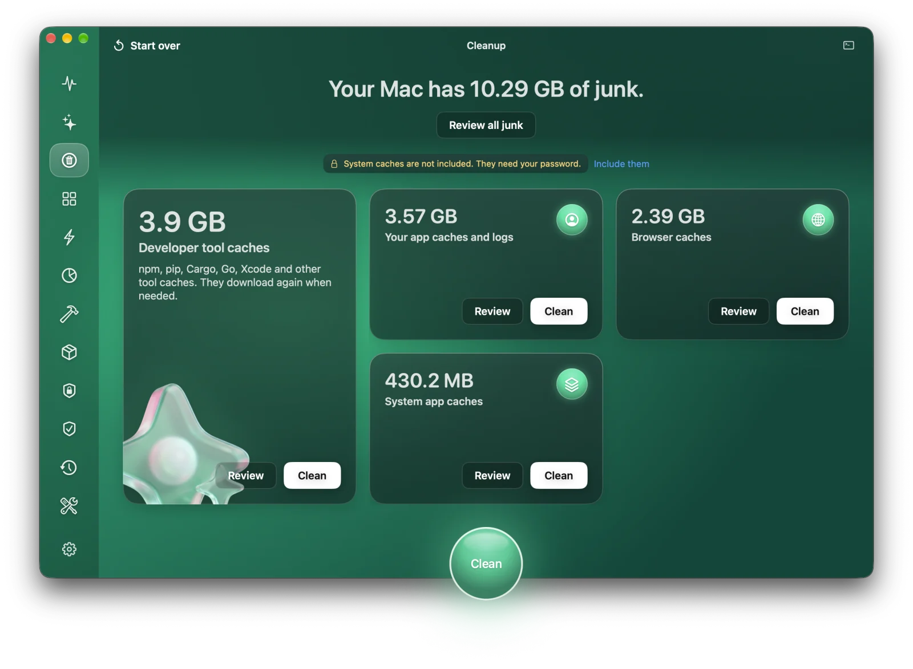 | 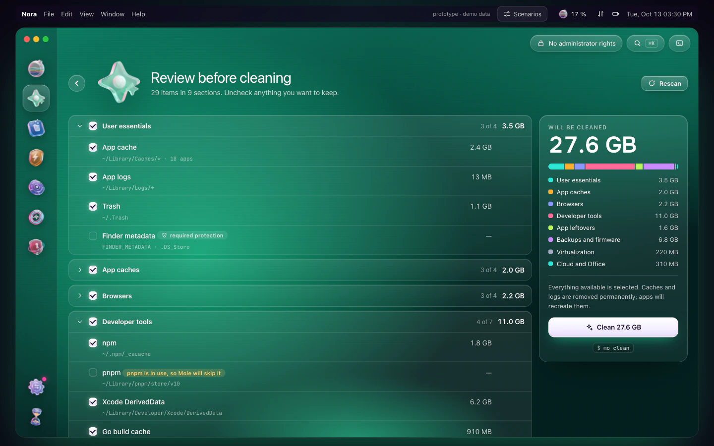 |
| **Cleanup:** start screen | **Review:** every path, size and protection rule |
| 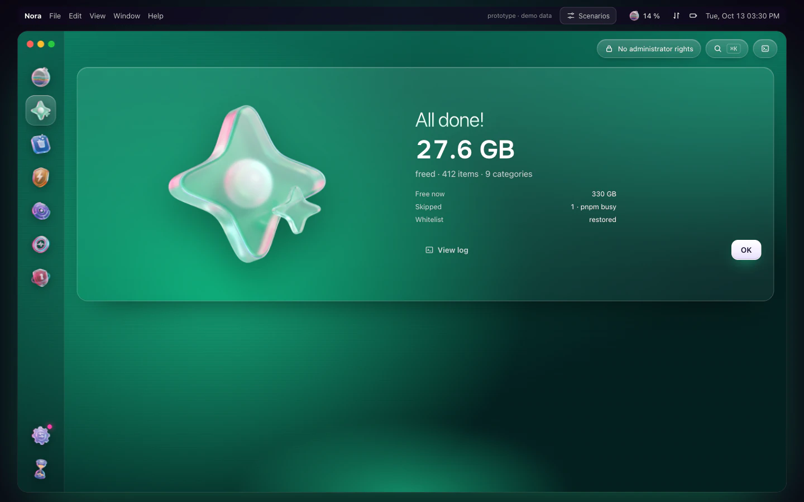 | 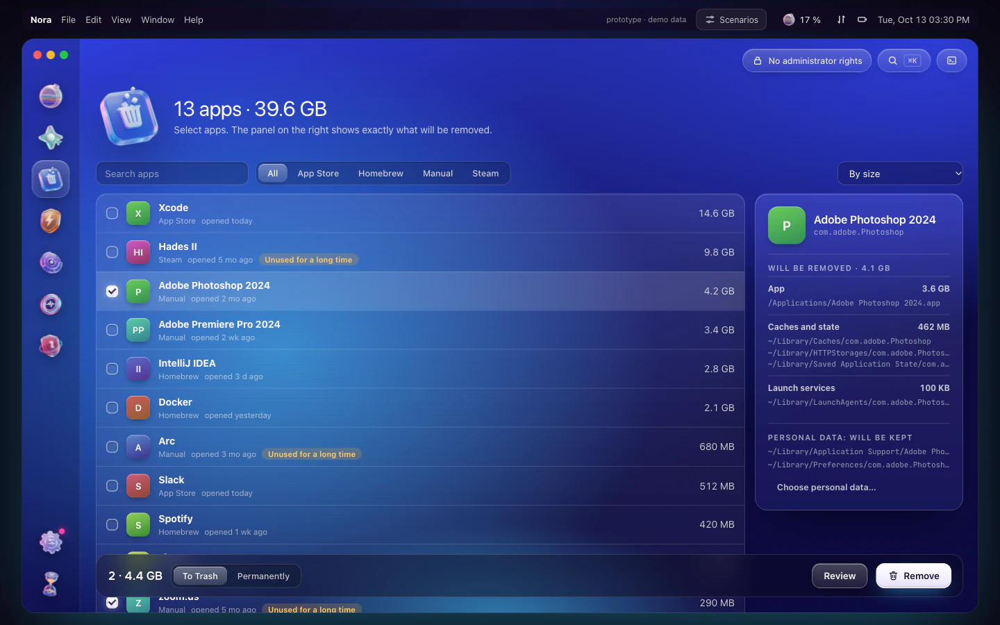 |
| **Done:** what was freed, with the log one click away | **Applications:** exactly what will be removed |
| 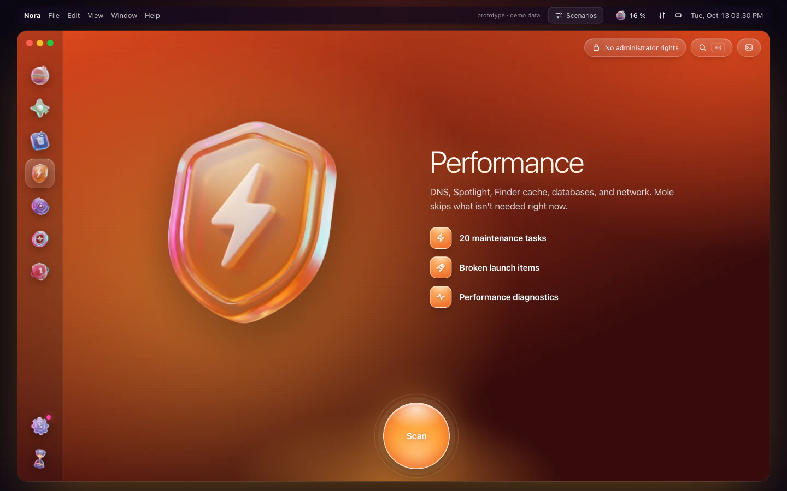 | 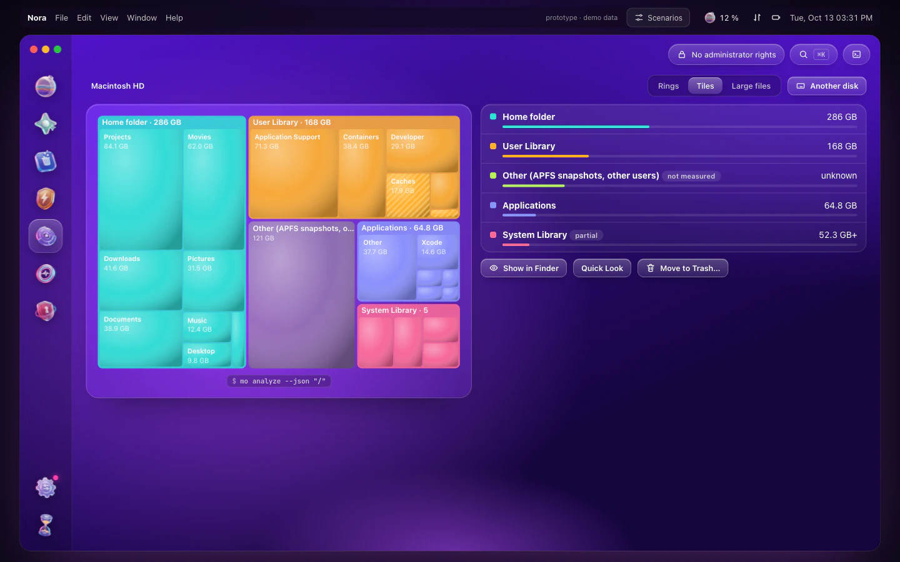 |
| **Performance:** maintenance tasks | **Space Map:** treemap with cleanable areas highlighted |
| 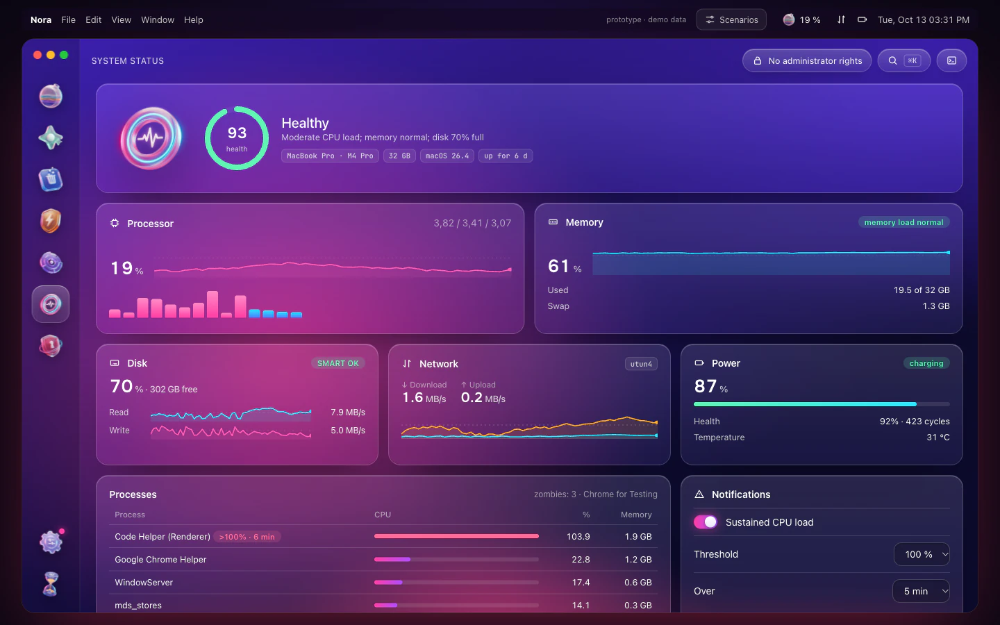 | 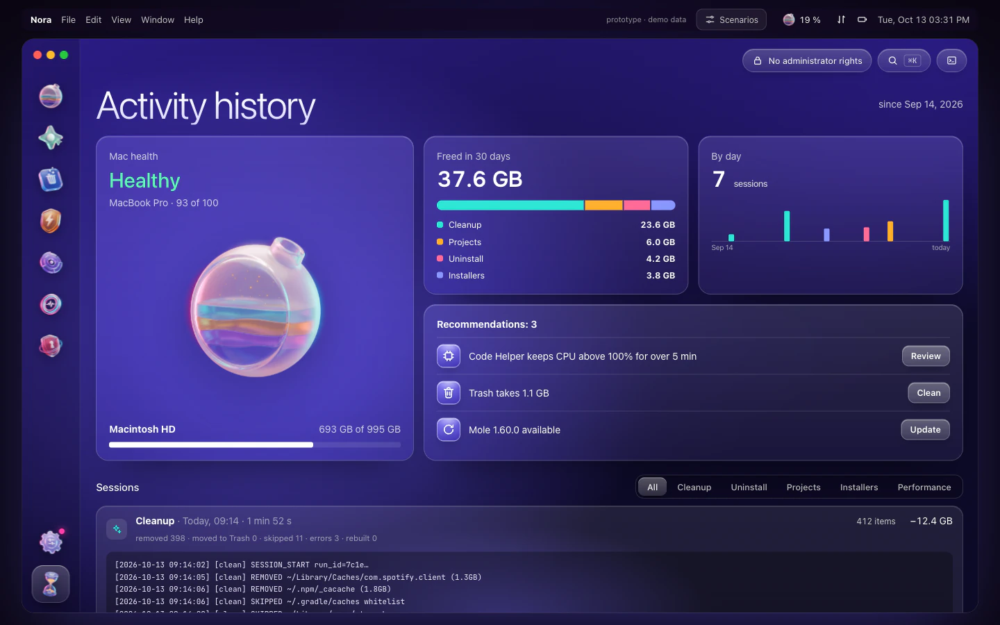 |
| **System Status:** live, from the NDJSON stream | **History:** activity dashboard |
| 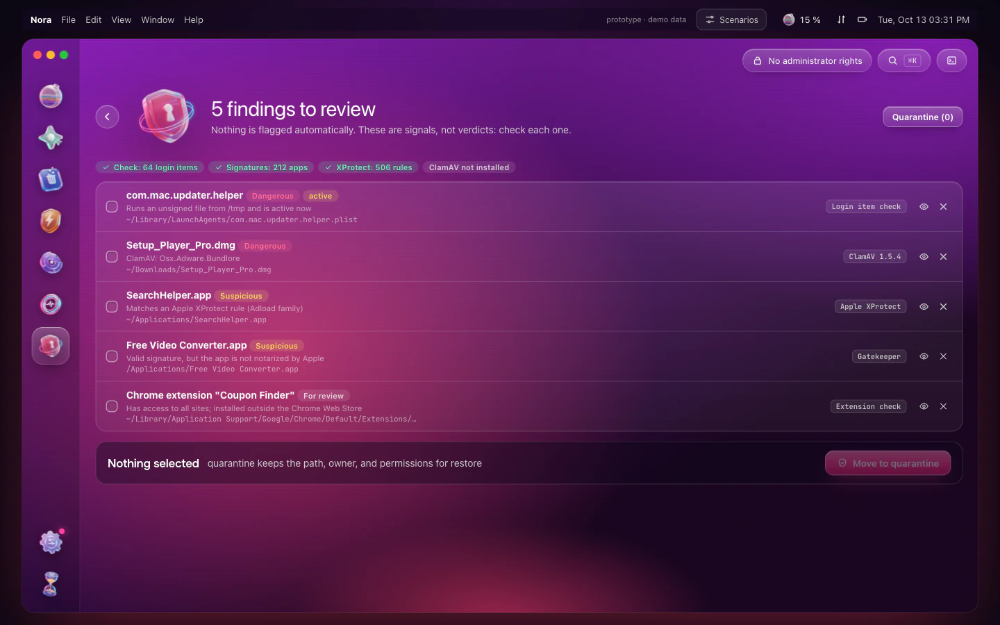 | 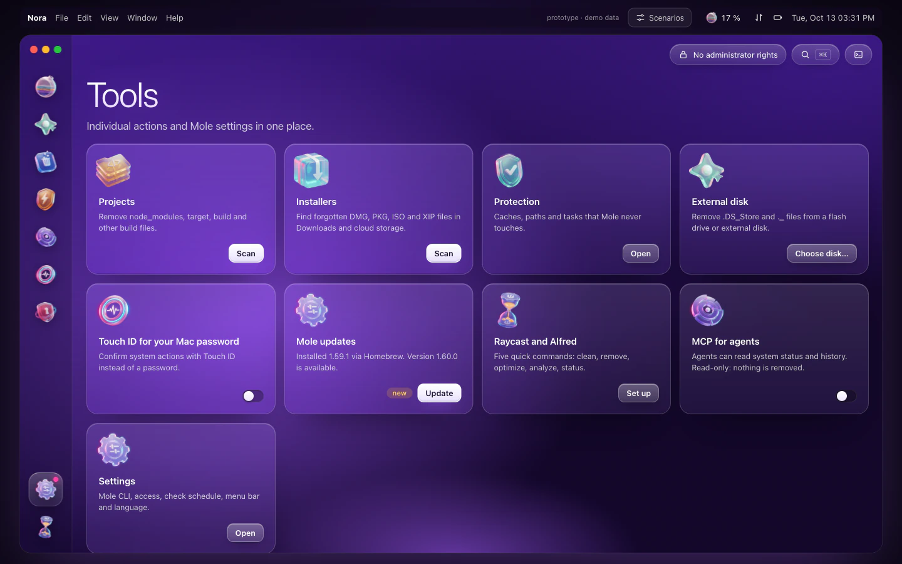 |
| **Security:** explained findings, nothing pre-selected | **Tools:** focused actions and settings |

## How to use it

1. **Open Nora.** If Mole is missing, Nora offers to install it, with no Terminal and no admin password.
2. **Pick a module** in the left rail, press <kbd>⌘1</kbd>…<kbd>⌘8</kbd>, or press <kbd>⌘K</kbd> for the command palette.
3. **Press *Scan*.** Nothing is deleted at this step. Nora runs Mole's preview.
4. **Review** the list. Uncheck anything you want to keep, or protect it permanently with the shield button.
5. **Run.** Nora shows the exact command. It asks for Touch ID only when system areas are included, and then reports the result. *View log* opens the console with Mole's full output.

The menu bar item (<kbd>⌥⌘N</kbd>) shows live stats. Right-click it for quick actions.

## Safety

- Nora never deletes on its own. Deletion always comes after a review and an explicit confirmation.
- Caches and logs removed by `mo clean`, and project build files removed by `mo purge`, are deleted permanently. Mole checks every path again before removing it. Uninstalled apps go to the Trash by default.
- Mole's 13 default protections (Ollama models, Gradle and JetBrains caches, Playwright browsers, iCloud…) and its mandatory safety rules stay in place when Nora edits the protected list.
- Administrator rights (your Mac password) are requested through the system dialog or Touch ID. Nora uses them only within the same session as the Mole command, and never stores them.
- No telemetry, so no usage data is sent. The only network calls are update checks (Nora and Mole) and the Mole installer download. You can see all of them in the console.

## Install

> [!IMPORTANT]
> The app is not released yet. When it is, download `Nora.dmg` from [Releases](https://github.com/Lexus2016/Nora/releases), open it, and drag **Nora** to **Applications**.

- macOS 14 Sonoma or later, Apple silicon or Intel.
- [Mole](https://github.com/tw93/Mole) 1.55 or later. Nora installs or updates it for you.
- Full Disk Access (a macOS permission) is recommended, so that Mail, Safari and some caches can be scanned. Nora guides you through it.

## Try the prototype

The approved interactive prototype runs in any modern browser. All data in it is demo data.

- Online: **https://lexus2016.github.io/Nora/prototype/**
- Locally: `cd prototype && python3 -m http.server 8000`, then open http://localhost:8000

Use the **Scenarios** button in the top bar to see the first-run, outdated-Mole, no-Full-Disk-Access and admin-session states.

## Documentation

- **Design & architecture:** [English](docs/en/DESIGN.md) · [Українська](docs/uk/DESIGN.md) · [Русский](docs/ru/DESIGN.md). Covers the full Mole feature inventory, every reference project and what we take from it, the coverage matrix and the mechanism behind each checkbox, the architecture, the design system, the roadmap and the risks.
- App icon sources: [`Design/AppIcon/`](Design/AppIcon/)

## Roadmap

- [x] Research: Mole internals, 4 GUI wrappers, 20+ open-source references
- [x] Approved design and interactive prototype
- [ ] **M0** Spike: PTY driver (a pseudo-terminal driver), whitelist overlay with crash recovery, `sudo -A` in PTY. *In progress: [MoleKit](MoleKit) PTY core, installer and uninstall drivers and the whitelist overlay pass end-to-end tests against Mole 1.59.1, and `sudo -A` in the PTY is confirmed. The purge driver is next.*
- [ ] **M1** Read-only: MoleKit, System Status (NDJSON), Space Map, History, menu bar
- [ ] **M2** Cleaning: Cleanup, Applications, Projects, Installers, Performance, Protection
- [ ] **M3** Look & feel: neon design system, realistic 3D glass assets, Smart Care, onboarding, EN/UK/RU copy
- [ ] **M4** Release: signed and notarized DMG, Sparkle updates
- [ ] **M5** Security module (ClamAV + XProtect YARA + persistence audit), scheduled checks, read-only MCP

## Credits & trademarks

- **Mole** is created by [tw93](https://github.com/tw93) and licensed under GPL-3.0. *Mole* and the Mole logo are trademarks of the Mole project. Nora is an **independent** project. It is not affiliated with or endorsed by Mole, and it is not the official [Mole for Mac](https://mole.fit) app.
- Design and research references: [MangelSP/MoleUI](https://github.com/MangelSP/MoleUI), [Zhili1004/MoleUI](https://github.com/Zhili1004/MoleUI), [gokuscraper/mole-gui](https://github.com/gokuscraper/mole-gui), [caezium/Burrow](https://github.com/caezium/Burrow), [exelban/stats](https://github.com/exelban/stats) and others listed in the design document.

## License

[PolyForm Noncommercial 1.0.0](LICENSE) © 2026 Lexus2016

You may use, copy, modify and share Nora's code for any noncommercial purpose: personal use, study, research and hobby projects, and use by charities, schools and public institutions. Commercial use needs a separate license from the author. Open an issue to ask.

Mole is a separate GPL-3.0 project. Nora runs it as an external program and does not include its code, so Mole's license is unaffected.
