

  

<h1 align="center">Nora</h1>

  <b>Красивое и честное приложение для macOS поверх <a href="https://github.com/tw93/Mole">Mole</a> CLI.</b> 
  Глубокая очистка · удаление программ · быстродействие · карта диска · живое состояние системы. В одном неоново-стеклянном окне и в строке меню.

  <a href="README.md">English</a> · <a href="README.uk.md">Українська</a> · <b>Русский</b>

  
  
  
  

  <a href="https://lexus2016.github.io/Nora/prototype/"><b>▶ Попробовать интерактивный прототип</b></a>

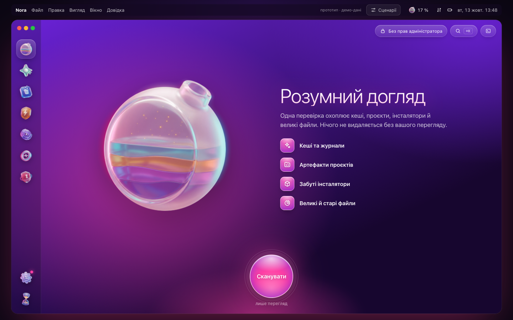

> [!NOTE]
> **Состояние проекта.** Дизайн и интерактивный прототип утверждены, нативное приложение на SwiftUI в разработке. Подписанные DMG появятся на странице [Releases](https://github.com/Lexus2016/Nora/releases). Нажмите *Watch*, чтобы не пропустить.
>
> Интерфейс прототипа и скриншоты пока на украинском языке. В приложении будут английский, украинский и русский.

## Зачем Nora

[Mole](https://github.com/tw93/Mole) — отличный открытый набор инструментов командной строки, объединяющий возможности CleanMyMac, AppCleaner, DaisyDisk и iStat Menus. Nora даёт ему спокойное, нативное и красивое лицо и ничего не скрывает.

- **Сначала просмотр, потом удаление.** Каждый модуль работает одинаково: *Сканировать → Просмотреть → Готово*. Вы видите каждый путь и размер до того, как Mole что-либо сделает.
- **Честные чекбоксы.** Чекбокс появляется только тогда, когда Nora может заставить Mole его выполнить. Снятые позиции защищает временный whitelist Mole, который Nora потом возвращает. На запросы в интерактивных меню Mole Nora отвечает только после сверки списка на экране с вашим выбором. Никаких декоративных галочек.
- **Ничего не спрятано.** Каждое действие показывает точную команду `mo …`, а встроенная консоль — живой вывод Mole.
- **Сама устанавливает и обновляет Mole.** Один клик и без Терминала: через Homebrew, если он есть; иначе — официальный установщик Mole зафиксированной версии с проверкой контрольной суммы, в `~/.local/bin` и без пароля администратора. Nora и сама обновляется (Sparkle 2, подписанный канал).
- **Меню быстрого доступа в строке меню.** Живые здоровье системы, CPU, память, сеть, диск, графика, вентилятор, батарея, топ-процессы и место, которое можно освободить. Оттуда же — переход в любой раздел в один клик.
- **Нативная и лёгкая.** SwiftUI + AppKit. Nora управляет уже установленным Mole, без собственного «движка».
- **Ваш язык — автоматически.** Английский, украинский или русский, в зависимости от языка macOS. Для остальных языков — английский.

## Возможности

| Модуль | Что делает | Под капотом |
|---|---|---|
| **Умный уход** | Одна проверка без удаления: кэши, артефакты проектов, установщики, большие файлы; затем один безопасный *Запуск* | `mo clean --dry-run`, `mo purge --dry-run`, `mo installer --dry-run`, `mo analyze --json` |
| **Очистка** | Кэши, журналы, остатки удалённых программ, Корзина; по желанию системные кэши (Touch ID или пароль) | `mo clean` + whitelist-оверлей, `sudo -A` в той же PTY-сессии |
| **Программы** | Удаление вместе с LaunchAgents, кэшами и настройками; личные данные сохраняются; в Корзину или навсегда | `mo uninstall --list` (JSON), `mo uninstall [--permanent] "Программа"` |
| **Быстродействие** | 20 задач обслуживания (DNS, Spotlight, кэш Finder, базы данных, сеть…), каждую можно отключить | `mo optimize`, `~/.config/mole/whitelist_optimize` |
| **Анализ диска** | Кольца и плитки, переход вглубь, инсайты (старые загрузки, резервные копии iOS, данные Xcode/Docker), большие файлы, внешние диски | `mo analyze --json PATH` |
| **Состояние системы** | Здоровье, CPU по ядрам, давление памяти, I/O диска, сеть, батарея, температуры, Bluetooth, процессы, CPU-алерты | `mo status --watch --interval 1s` (NDJSON) |
| **Проекты** | `node_modules`, `target`, `build`, `.venv`… по проектам; недавно активные не трогаются | `mo purge [--yes]` |
| **Установщики** | Забытые DMG / PKG / ISO / XIP / ZIP в Загрузках, iCloud, Почте, Telegram, Homebrew | `mo installer` |
| **История** | Панель активности: освобождённое место, сессии, рекомендации, полный журнал операций | `mo history --json` |
| **Защита** | Чего Mole не должен трогать никогда: правила кэшей, свои пути, исключённые задачи, папки поиска проектов | `~/.config/mole/*` |
| **Инструменты** | Touch ID для sudo, очистка метаданных на внешних дисках, обновление Mole, автодополнение, Raycast / Alfred, MCP только на чтение для AI-агентов | `mo touchid`, `mo clean --external`, `mo update` |
| **Безопасность** *(запланировано)* | Проверка на вредоносное ПО по запросу: аудит автозапуска и LaunchAgents, проверка подписей и нотаризации, локальные YARA-правила Apple XProtect, движок ClamAV (устанавливается по запросу). Каждая находка объяснена и никогда не отмечается автоматически; из карантина файл можно восстановить | Security.framework, `yara`, `clamd` / `freshclam` |

## Скриншоты

| | |
|---|---|
| 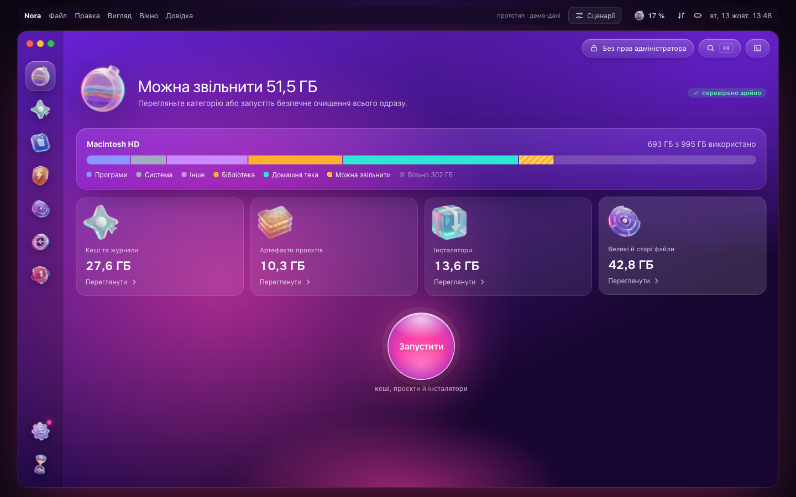 | 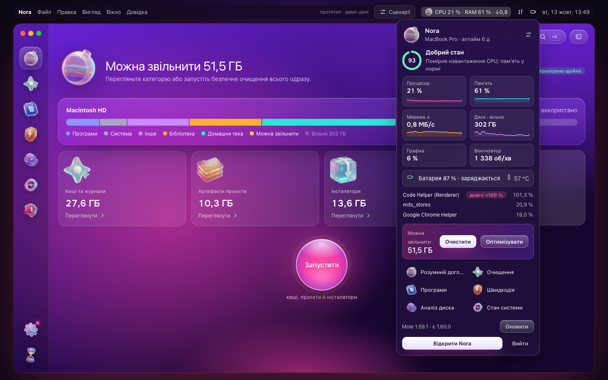 |
| **Умный уход:** всё, что можно освободить | **Строка меню:** живые показатели и быстрые переходы |
| 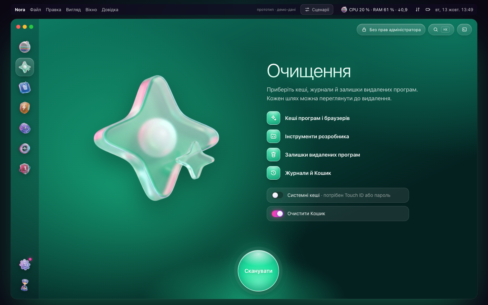 | 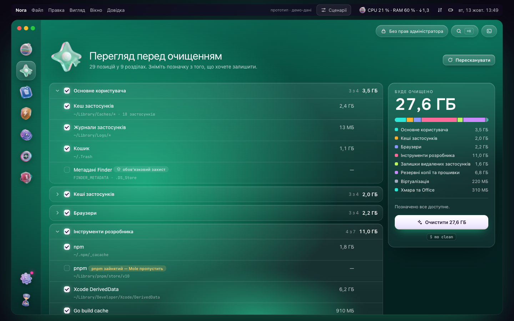 |
| **Очистка:** стартовый экран | **Просмотр:** каждый путь, размер и правило защиты |
| 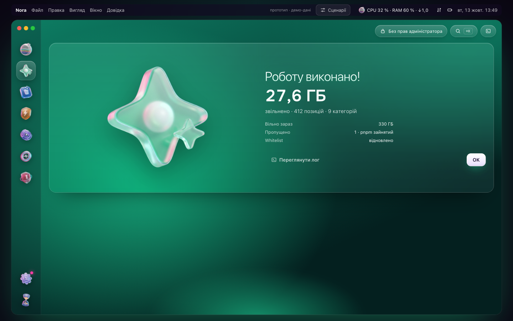 | 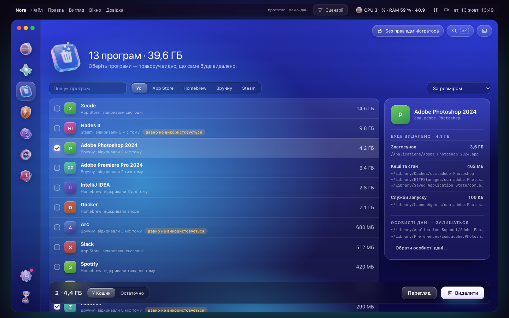 |
| **Готово:** сколько освобождено, лог в один клик | **Программы:** что именно будет удалено |
| 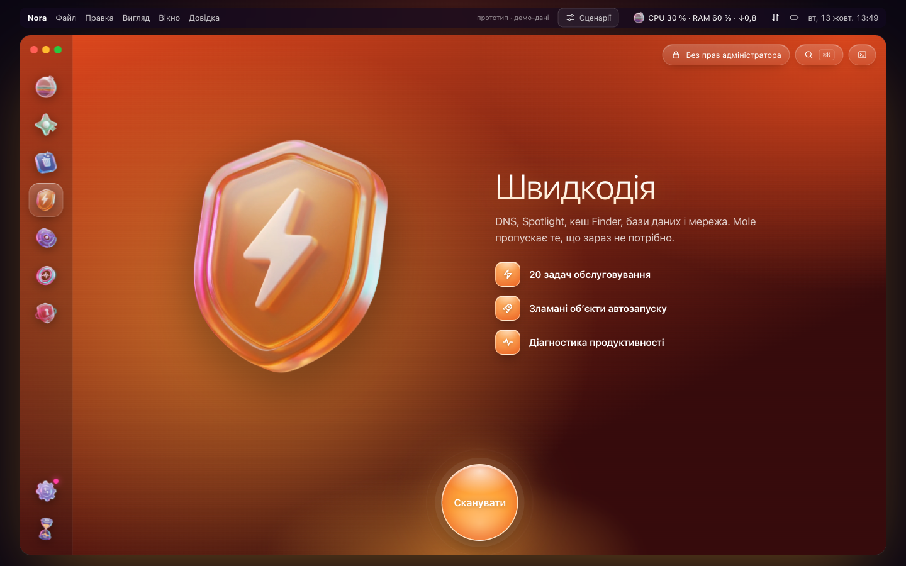 | 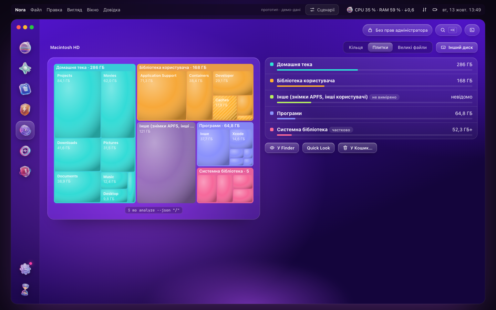 |
| **Быстродействие:** задачи обслуживания | **Анализ диска:** плитки с отмеченными зонами очистки |
| 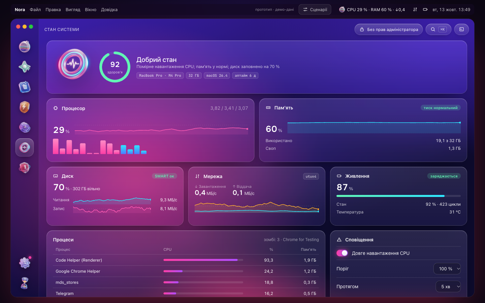 | 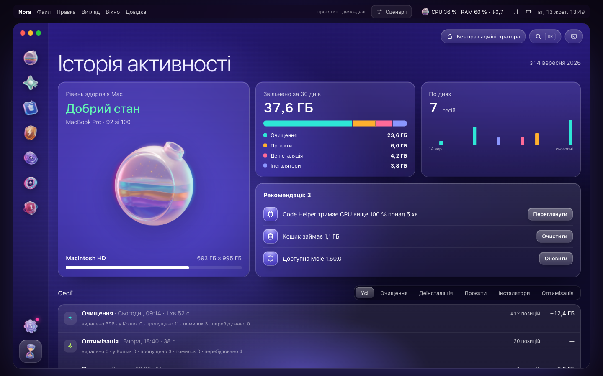 |
| **Состояние системы:** вживую из NDJSON-потока | **История:** панель активности |
| 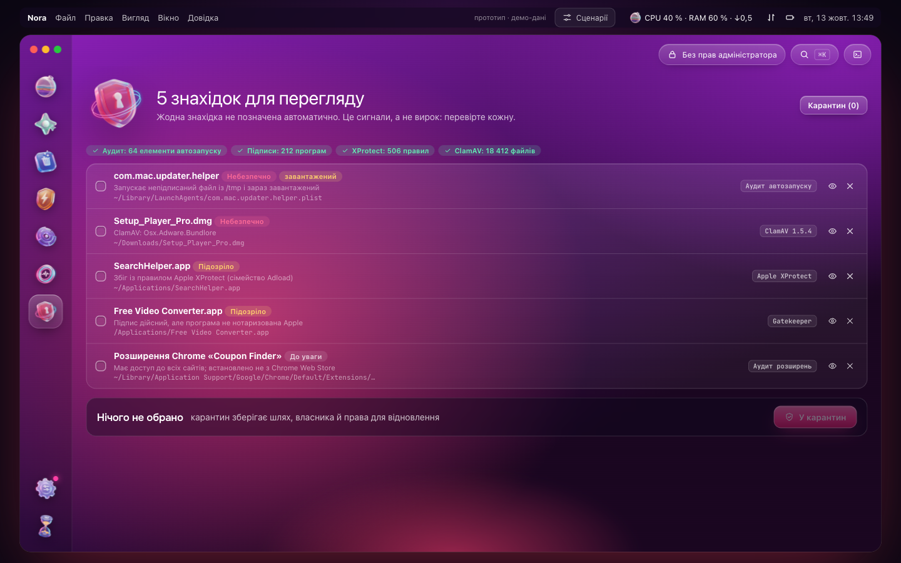 | 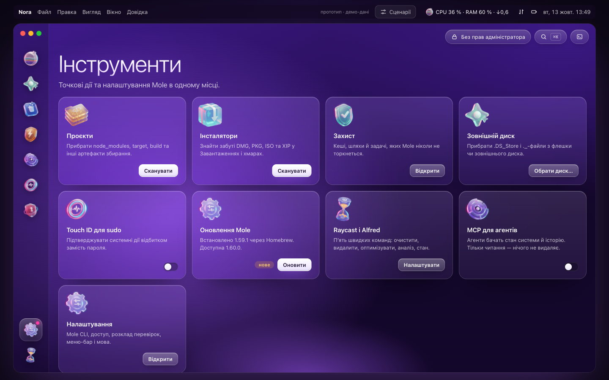 |
| **Безопасность:** объяснённые находки без автоотметок | **Инструменты:** точечные действия и настройки |

## Как пользоваться

1. **Откройте Nora.** Если Mole нет, Nora предложит установить его — без Терминала и без пароля администратора.
2. **Выберите модуль** на панели слева (или <kbd>⌘1</kbd>…<kbd>⌘8</kbd>, или <kbd>⌘K</kbd> для палитры команд).
3. **Нажмите «Сканировать».** На этом шаге ничего не удаляется: Nora запускает предварительный просмотр Mole.
4. **Просмотрите список.** Снимите отметку с того, что хотите оставить, или защитите навсегда кнопкой со щитом.
5. **Запустите.** Nora покажет точную команду, попросит Touch ID только для системных зон и покажет результат. «Посмотреть лог» открывает консоль с полным выводом Mole.

Пункт в строке меню (<kbd>⌥⌘N</kbd>) показывает живые показатели; правая кнопка открывает быстрые действия.

## Безопасность

- Nora никогда ничего не удаляет сама: удаление бывает только после просмотра и явного подтверждения.
- Кэши и журналы (`mo clean`) и артефакты проектов (`mo purge`) удаляются безвозвратно; Mole перепроверяет каждый путь перед удалением. Программы по умолчанию уходят в Корзину.
- 13 стандартных защит Mole (модели Ollama, кэши Gradle и JetBrains, браузеры Playwright, iCloud…) и его обязательные правила сохраняются, когда Nora меняет whitelist.
- Права администратора запрашиваются через системное окно или Touch ID, используются в пределах одной сессии с командой Mole и никогда не сохраняются.
- Без телеметрии. Сеть используется только для проверки обновлений (Nora и Mole) и загрузки установщика Mole, и всё это видно в консоли.

## Установка

> [!IMPORTANT]
> Приложение ещё не выпущено. Когда выйдет, скачайте `Nora.dmg` со страницы [Releases](https://github.com/Lexus2016/Nora/releases), откройте и перетащите **Nora** в **Программы**.

- macOS 14 Sonoma или новее, Apple silicon или Intel.
- [Mole](https://github.com/tw93/Mole) 1.55 или новее — Nora установит или обновит его сама.
- Рекомендуется выдать полный доступ к диску, чтобы сканировались Почта, Safari и часть кэшей. Nora подскажет, как это сделать.

## Прототип

Утверждённый интерактивный прототип работает в любом современном браузере; все данные в нём демонстрационные.

- Онлайн: **https://lexus2016.github.io/Nora/prototype/**
- Локально: `cd prototype && python3 -m http.server 8000` → http://localhost:8000

Переключатель **«Сценарії»** вверху показывает состояния первого запуска, устаревшего Mole, отсутствия полного доступа к диску и сессии администратора.

## Документация

- **Дизайн и архитектура:** [English](docs/en/DESIGN.md) · [Українська](docs/uk/DESIGN.md) · [Русский](docs/ru/DESIGN.md). Полный перечень возможностей Mole, все референсы и что мы из них берём, матрица покрытия с механизмом каждого чекбокса, архитектура, дизайн-система, этапы и риски.
- Исходники иконки: [`Design/AppIcon/`](Design/AppIcon/)

## План работ

- [x] Исследование: устройство Mole, 4 GUI-обёртки, более 20 открытых референсов
- [x] Утверждённый дизайн и интерактивный прототип
- [ ] **M0** Спайк: PTY-драйвер, whitelist-оверлей с восстановлением после сбоя, `sudo -A` в PTY. *В работе: ядро PTY в [MoleKit](MoleKit), драйвер установщиков и whitelist-оверлей проходят сквозные тесты на Mole 1.59.1; дальше — драйверы uninstall и purge.*
- [ ] **M1** Режим чтения: MoleKit, Состояние системы (NDJSON), Анализ диска, История, строка меню
- [ ] **M2** Очистка: Очистка, Программы, Проекты, Установщики, Быстродействие, Защита
- [ ] **M3** Внешний вид: неоновая дизайн-система, реалистичные стеклянные 3D-ассеты, Умный уход, онбординг, тексты EN/UK/RU
- [ ] **M4** Выпуск: подписанный и нотаризованный DMG, обновления через Sparkle
- [ ] **M5** Модуль «Безопасность» (ClamAV + XProtect YARA + аудит автозапуска), проверки по расписанию, MCP только на чтение

## Благодарности и товарные знаки

- **Mole** создан [tw93](https://github.com/tw93), лицензия GPL-3.0. *Mole* и логотип Mole — товарные знаки проекта Mole. Nora — **независимый** проект, не связанный с Mole и не одобренный им, и не является официальным приложением [Mole for Mac](https://mole.fit).
- Референсы дизайна и исследования: [MangelSP/MoleUI](https://github.com/MangelSP/MoleUI), [Zhili1004/MoleUI](https://github.com/Zhili1004/MoleUI), [gokuscraper/mole-gui](https://github.com/gokuscraper/mole-gui), [caezium/Burrow](https://github.com/caezium/Burrow), [exelban/stats](https://github.com/exelban/stats) и другие — полный список в дизайн-документе.

## Лицензия

[PolyForm Noncommercial 1.0.0](LICENSE) © 2026 Lexus2016

Код Nora можно использовать, копировать, изменять и распространять с любой некоммерческой целью: для себя, для учёбы, исследований и хобби-проектов, а также в благотворительных, образовательных и государственных организациях. Для коммерческого использования нужна отдельная лицензия от автора: напишите в issue.

Mole — отдельный проект под GPL-3.0. Nora запускает его как внешнюю программу и не содержит его кода, поэтому лицензия Mole не меняется.
