

  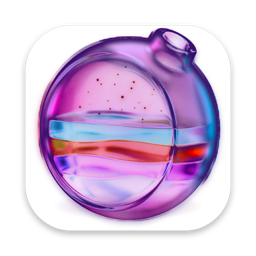

<h1 align="center">Nora</h1>

  <b>Нативное приложение для macOS к инструменту командной строки <a href="https://github.com/tw93/Mole">Mole</a>.</b> 
  Чистит Mac, удаляет программы вместе с остатками, ускоряет систему, показывает, что занимает диск, следит за состоянием системы в реальном времени и проверяет на вредоносное ПО. Всё в одном стеклянном окне и в меню-баре.

  <a href="README.md">English</a> · <a href="README.uk.md">Українська</a> · <b>Русский</b>

  
  
  
  

  <a href="https://github.com/Lexus2016/Nora/releases/latest"><b>⬇ Скачать Nora для macOS</b></a>

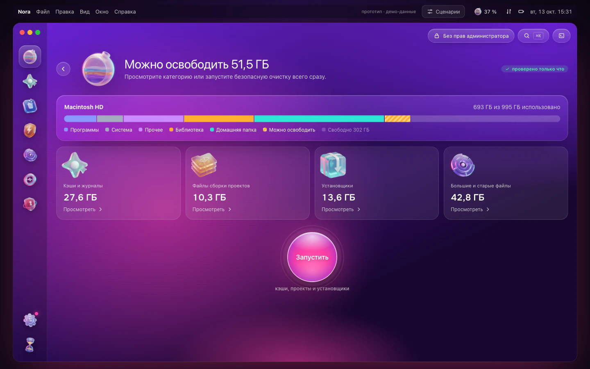

## Зачем Nora

[Mole](https://github.com/tw93/Mole) является бесплатным открытым набором инструментов. Он делает то же, что CleanMyMac, AppCleaner, DaisyDisk и iStat Menus, но работает в Терминале. Nora даёт Mole нативное окно для Mac и не прячет, что происходит внутри.

- **Ничего не удаляется без вашего просмотра.** Каждый раздел работает одинаково: Сканировать, Просмотреть, Готово. Сначала вы видите каждый элемент и его размер.
- **Галочкам можно верить.** Снятую галочку Nora действительно соблюдает: на время запуска она защищает этот элемент и сверяет собственный экран подтверждения Mole с вашим выбором. Если что-то не совпадает, Nora отменяет действие, и ничего не удаляется.
- **Ничего скрытого.** Консоль (<kbd>⌘J</kbd>) показывает каждую команду, которую запустила Nora, и полный вывод Mole. В Настройках можно включить показ точной команды под каждым действием.
- **Встроенный антивирус.** ClamAV и собственные правила Apple XProtect проверяют программы, загрузки и элементы автозапуска. ClamAV ставится одним кликом, а Nora ежедневно обновляет его вирусную базу, пока работает.
- **Сама устанавливает Mole.** Терминал не нужен. Если есть Homebrew, Nora использует его. Если нет, запустит официальный установщик Mole с закреплённой версией и проверенной контрольной суммой. Пароль администратора не нужен.
- **Быстрое меню в меню-баре.** Состояние системы, четыре показателя на ваш выбор, что сильнее всего нагружает Mac, сколько места можно освободить, и переход в любой раздел (<kbd>⌥⌘N</kbd>).
- **Нативная и лёгкая.** SwiftUI и AppKit, универсальное приложение для Apple silicon и Intel. Nora запускает ваш Mole и не встраивает собственный движок.
- **Многоязычная.** Nora говорит на языке вашего Mac, если знает его, иначе по-английски. Новые языки уже в планах.

## Возможности

| Раздел | Что делает | Как работает |
|---|---|---|
| **Умный уход** | Одно сканирование для мусора, обслуживания, папок сборки и установщиков. «Запустить» выполняет все отмеченные задачи по очереди | `mo clean`, `mo optimize`, `mo purge`, `mo installer` (сначала просмотр) |
| **Очистка** | Кэши, журналы и остатки по категориям. Снимите галочку, чтобы оставить. Системные кэши по желанию, с паролем или Touch ID | `mo clean` с временным списком защиты |
| **Программы** | Удаляет программу с её помощниками, кэшами и настройками (в Корзину или окончательно), обновляет программы, установленные через Homebrew или скачанные из интернета, находит программы, которые вы не открываете, и самые большие | `mo uninstall`, `brew`, каналы обновлений программ |
| **Быстродействие** | Что замедляет Mac прямо сейчас и 20 задач обслуживания (DNS, Spotlight, кэши Finder, базы данных, сеть) | `mo optimize` |
| **Анализ диска** | Папки в виде пузырей и списка, большие файлы, переход вглубь и перемещение в Корзину | `mo analyze --json` |
| **Состояние системы** | Оценка состояния, процессор, память, диски, сеть, энергия и температуры, режим энергопотребления, трафик по программам, открытые порты, батарея, Bluetooth | `mo status --watch`, системные счётчики |
| **Проекты** | `node_modules`, `target`, `build`, `.venv` и другое, сгруппировано по проектам. Недавно активные проекты не трогаются | `mo purge` |
| **Установщики** | Забытые DMG, PKG, ZIP и похожие файлы в Загрузках, iCloud, Почте и Telegram, в Корзину | `mo installer` |
| **История** | Освобождённое место, сессии и ежедневный график | `mo history --json` |
| **Защита** | Чего Mole никогда не должен трогать: правила очистки, задачи обслуживания, папки проектов | `~/.config/mole/*` |
| **Безопасность** | Элементы автозапуска и их подписи, правила Apple XProtect и антивирусная проверка ClamAV. Каждая находка объясняется, и ни одна не отмечается заранее. Карантин с возвратом одним кликом, проверки по расписанию по желанию | Security.framework, `yara`, ClamAV |
| **Инструменты** | Touch ID для sudo, очистка внешних дисков, обновление Mole, автодополнение в оболочке | `mo touchid`, `mo clean --external`, `mo update` |

## Антивирус и безопасность

Модуль **«Безопасность»** проверяет Mac тремя способами и показывает находки как сигналы для просмотра. Без вашего клика ничего не перемещается.

| Проверка | Что именно проверяет |
|---|---|
| **Элементы автозапуска** | Все программы, которые запускаются сами: ваши агенты запуска, системные агенты и демоны. Nora отмечает программу, которой нет на диске или которая не подписана, сломанную подпись, программу во временной, общей или скрытой папке, а также аргументы, которые передают загруженное в оболочку, декодируют base64 или запускают AppleScript |
| **Правила Apple XProtect** | Правила против вредоносного ПО, которые поставляет сама macOS. Nora запускает их через `yara` по сканируемым файлам |
| **ClamAV** | Открытый антивирусный движок и его база известного вредоносного ПО |

- **Что сканируется.** «Быстрая» проверка охватывает элементы автозапуска, «Программы», «Загрузки» и «Рабочий стол». «Полная» охватывает всю домашнюю папку, кроме папок iCloud.
- **Установка одним кликом.** ClamAV не входит в Nora. Кнопка «Установить ClamAV через Homebrew» ставит его вместе с `yara` и сразу загружает вирусную базу: около 57 МБ занимает программа и 110 МБ база. Если Homebrew нет, Nora даст ссылку на brew.sh.
- **База всегда свежая.** Пока Nora работает, в окне или в меню-баре, она раз в сутки обновляет вирусную базу. Перед ручным сканированием обновляет базу старше суток. Если обновить не удалось, сканирование всё равно идёт, а Nora показывает дату базы, с которой работала.
- **Когда что-то найдено.** Для каждой находки объяснено, почему она отмечена, и ни одна не выбрана за вас. «Карантин» переносит файл в собственную папку Nora (агент запуска сначала выгружается), а «Восстановить» возвращает его на место. Окончательное удаление из карантина просит подтверждения.
- **По желанию, в «Настройки → Безопасность».** Сканирование по расписанию, ежедневно или еженедельно, с уведомлением, когда что-то найдено. «Следить за Загрузками» проверяет новые файлы в «Загрузках», как только они появляются. Для этого база ClamAV держится в памяти (около 1 ГБ, до 2,4 ГБ во время ежедневного обновления), поэтому по умолчанию слежение выключено.
- **Чего Nora не обещает.** Это не защита в реальном времени: следить за каждым доступом к файлам ClamAV умеет только на Linux. Nora работает вместе со встроенными в macOS XProtect и Gatekeeper и не заменяет их.

## Скриншоты

| | |
|---|---|
| 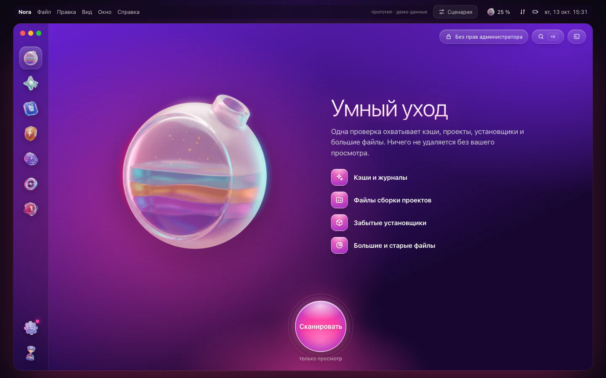 | 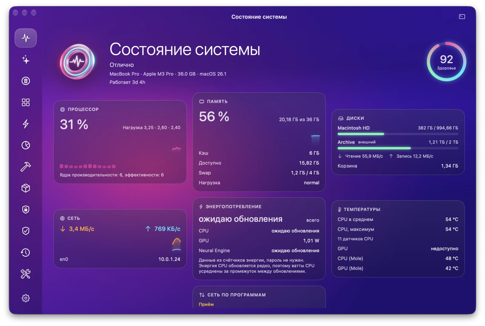 |
| **Умный уход:** одно сканирование для всего | **Меню-бар:** показатели в реальном времени и быстрые переходы |
| 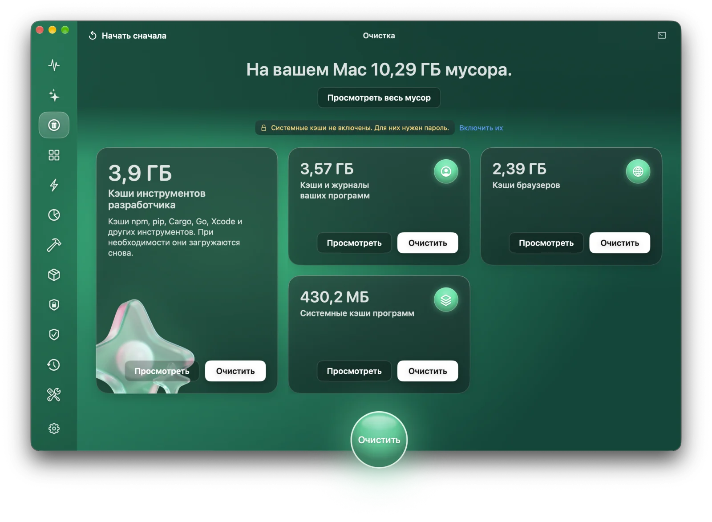 | 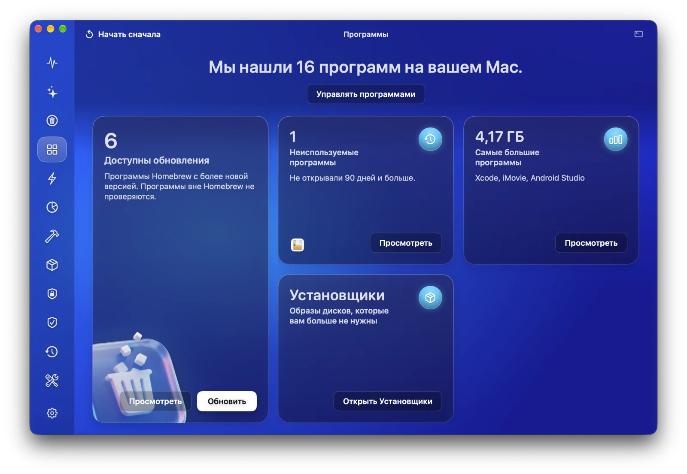 |
| **Очистка:** мусор по категориям, просмотр перед очисткой | **Программы:** обновления, неиспользуемые и самые большие программы |
| 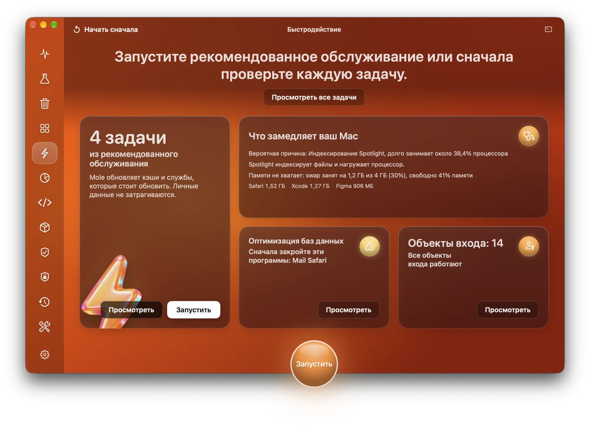 | 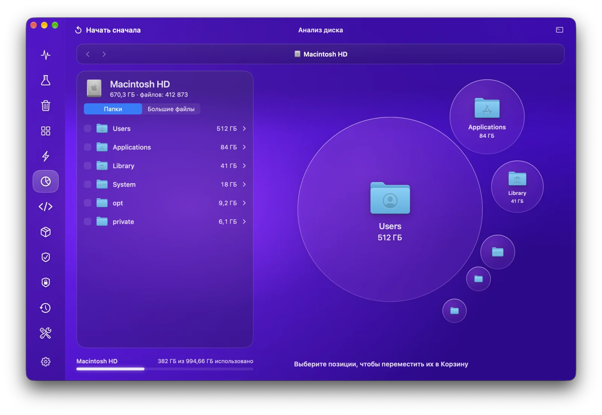 |
| **Быстродействие:** что замедляет Mac и что запустить | **Анализ диска:** что занимает место |
| 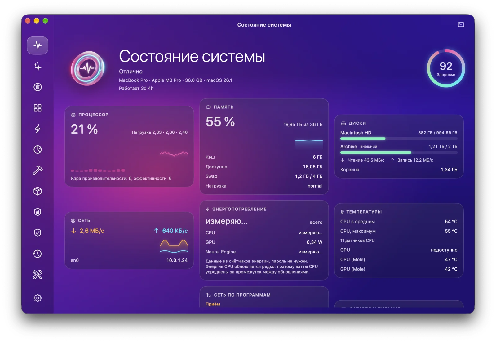 | 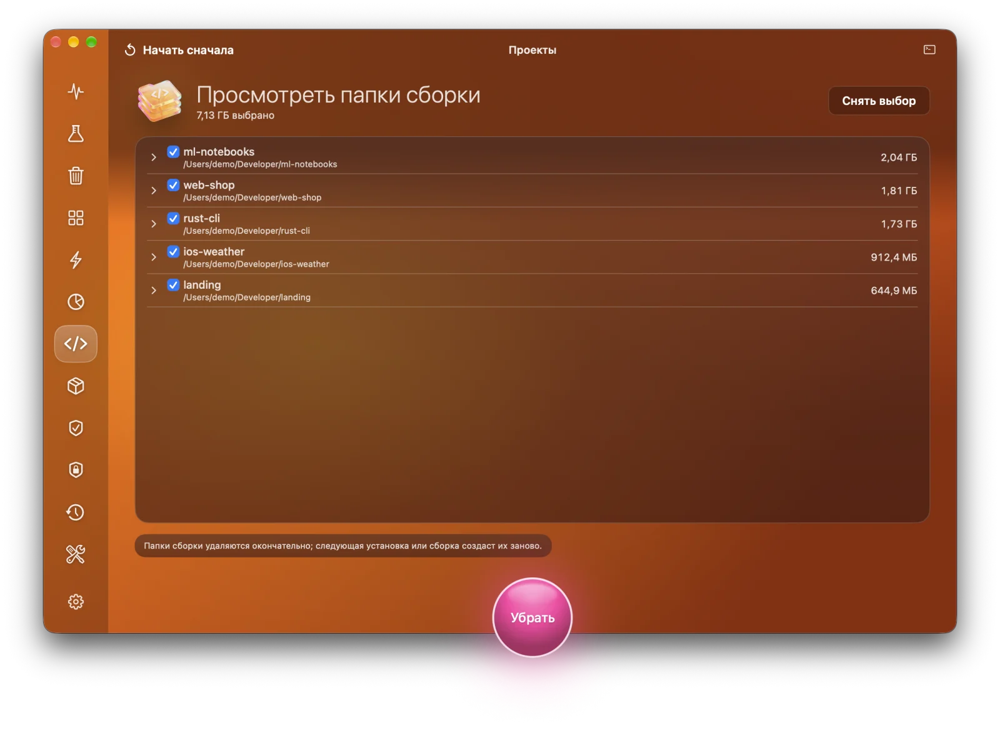 |
| **Состояние системы:** в реальном времени, каждую секунду | **Проекты:** папки сборки по проектам |
| 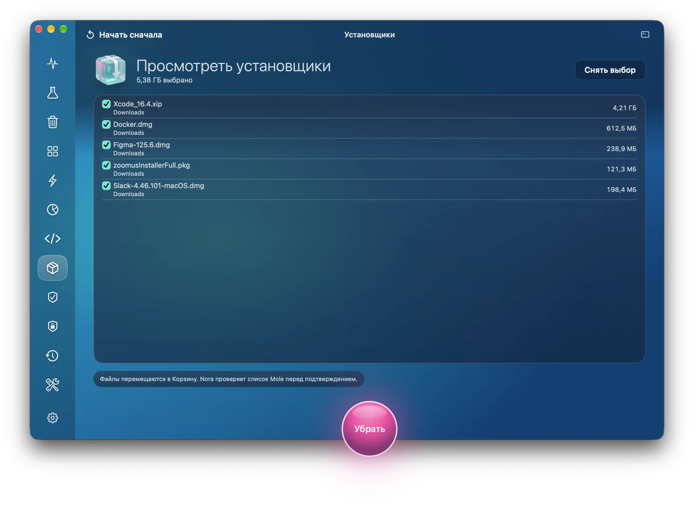 | 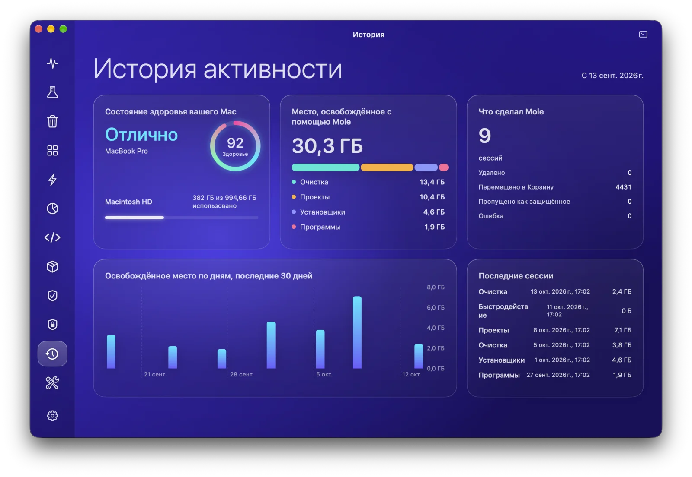 |
| **Установщики:** забытые образы дисков | **История:** что сделал Mole |
| 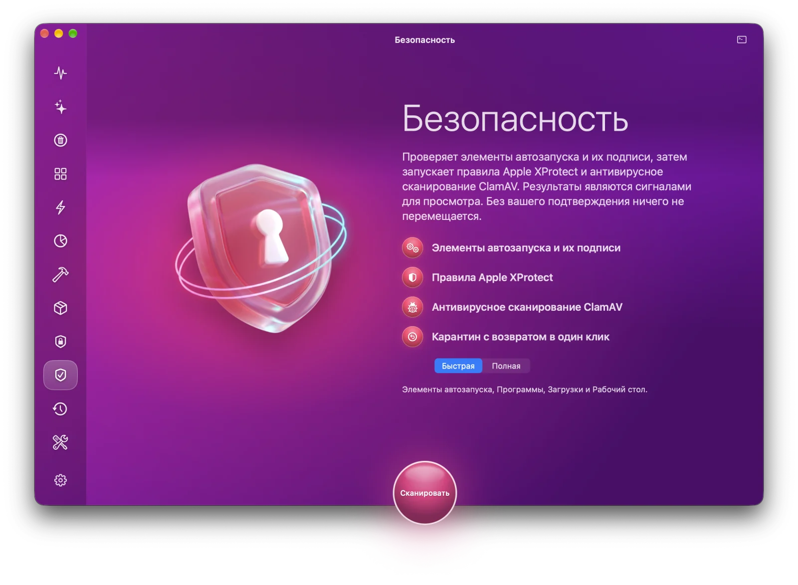 | 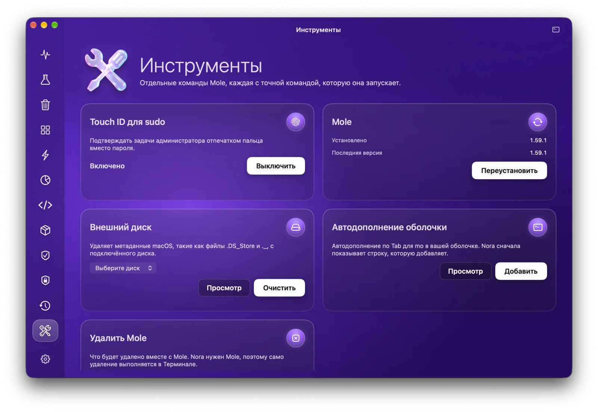 |
| **Безопасность:** сигналы для просмотра, без вашего клика ничего не перемещается | **Инструменты:** небольшие команды Mole |

На скриншотах демонстрационные данные.

## Установка

1. Скачайте `Nora-1.1.0.dmg` из [последнего выпуска](https://github.com/Lexus2016/Nora/releases/latest).
2. Откройте его и перетащите **Nora** в **Программы**.
3. Запустите Nora. Если Mole нет, Nora установит его сама.

- macOS 14 Sonoma или новее, Apple silicon или Intel.
- Приложение подписано Developer ID и нотаризовано Apple, поэтому открывается без предупреждений.
- Nora обновляется сама через Sparkle, а Mole обновляется из раздела «Инструменты».
- Рекомендуем дать полный доступ к диску, чтобы сканировались Почта, Safari и Корзина. Nora подскажет, где его включить.

Как собрать Nora самостоятельно, описано в [docs/BUILD.md](docs/BUILD.md).

## Как пользоваться

1. Выберите раздел на боковой панели. Быстрее всего начать с **Умного ухода**.
2. Нажмите **Сканировать**. На этом шаге ничего не удаляется: Nora запускает просмотр Mole.
3. Просмотрите список. Снимите галочки с того, что хотите оставить, или защитите навсегда в разделе **Защита**.
4. Нажмите круглую кнопку, чтобы запустить. Пароль Nora спрашивает, только когда включены системные области, а затем показывает, что сделано. **Показать журнал** открывает полный вывод Mole.

## Безопасность данных

- Nora никогда ничего не удаляет сама. Удаление всегда идёт после просмотра и вашего клика.
- Кэши, журналы и папки сборки удаляются окончательно, как и в Mole; перед этим Mole ещё раз проверяет каждый путь. Программы и установщики уходят в Корзину. Окончательное удаление программы Nora переспрашивает. Когда Homebrew забирает себе программу, скачанную из интернета, старая копия сначала уходит в Корзину и возвращается, если установка не удалась.
- Когда Nora меняет список защиты Mole, собственные защиты Mole по умолчанию и правила безопасности остаются на месте.
- Пароль идёт напрямую к `sudo` через системное окно или Touch ID. Nora его не видит и не хранит.
- Никакой телеметрии. Nora выходит в интернет только чтобы проверить обновления Nora, Mole и ваших программ (публичный список программ Homebrew и собственные каналы обновлений программ), установить Mole и обновить базу ClamAV, если вы установили ClamAV.

Известные ограничения, потому что так работает Mole: папки сборки Mole удаляет через повторное сканирование, а не по списку, поэтому папка, появившаяся за несколько секунд до удаления, не защищена; установщики распознаются по имени, папке и размеру, потому что меню Mole не показывает полный путь.

## Документация

- **Дизайн и архитектура:** [English](docs/en/DESIGN.md) · [Українська](docs/uk/DESIGN.md) · [Русский](docs/ru/DESIGN.md)
- **Сборка и выпуск:** [docs/BUILD.md](docs/BUILD.md)
- **Ранний концепт дизайна:** [интерактивный браузерный прототип](https://lexus2016.github.io/Nora/prototype/), из которого выросло приложение

## План развития

- [x] Исследование, дизайн и интерактивный прототип
- [x] Драйвер Mole: сессии псевдотерминала, накладка защиты с восстановлением после сбоя, `sudo` в той же сессии ([MoleKit](MoleKit))
- [x] Все разделы Mole, Умный уход, меню-бар, первый запуск, многоязычный интерфейс
- [x] Безопасность: автозапуск, правила XProtect, ClamAV, карантин, проверки по расписанию
- [x] 1.0: подписанный и нотаризованный DMG, обновления через Sparkle
- [ ] MCP-сервер только для чтения для ИИ-агентов
- [ ] Новые языки

## Благодарности и товарные знаки

- **Mole** создал [tw93](https://github.com/tw93), лицензия GPL-3.0. *Mole* и логотип Mole являются товарными знаками проекта Mole. Nora является **независимым** проектом. Он не связан с Mole и не одобрен им, и это не официальное приложение [Mole for Mac](https://mole.fit).
- **ClamAV** разрабатывает [Cisco Talos](https://www.clamav.net), лицензия GPL-2.0. ClamAV является зарегистрированным товарным знаком Cisco Systems, Inc. Nora не содержит ClamAV в себе: она запускает копию, которую вы установили через Homebrew, как отдельную программу. Nora не связана с Cisco и не одобрена ею.
- **[YARA](https://virustotal.github.io/yara/)** от VirusTotal (BSD-3-Clause) запускает правила Apple **XProtect**, которые Nora читает из macOS. XProtect, Gatekeeper и macOS являются товарными знаками Apple Inc.
- **[Sparkle](https://sparkle-project.org)** (MIT) доставляет обновления Nora. **[Homebrew](https://brew.sh)** (BSD-2-Clause) устанавливает Mole, ClamAV и `yara`.
- Референсы для дизайна и исследований: [MangelSP/MoleUI](https://github.com/MangelSP/MoleUI), [Zhili1004/MoleUI](https://github.com/Zhili1004/MoleUI), [gokuscraper/mole-gui](https://github.com/gokuscraper/mole-gui), [caezium/Burrow](https://github.com/caezium/Burrow), [exelban/stats](https://github.com/exelban/stats) и другие, перечисленные в документе дизайна.

## Лицензия

[PolyForm Noncommercial 1.0.0](LICENSE) © 2026 Lexus2016

Код Nora можно использовать, копировать, изменять и распространять с любой некоммерческой целью: для себя, для учёбы, исследований и хобби-проектов, а также благотворительным организациям, школам и государственным учреждениям. Для коммерческого использования нужна отдельная лицензия от автора. Откройте issue, чтобы спросить.

Mole является отдельным проектом под GPL-3.0. Nora запускает его как внешнюю программу и не содержит его кода, поэтому лицензия Mole не затрагивается.
