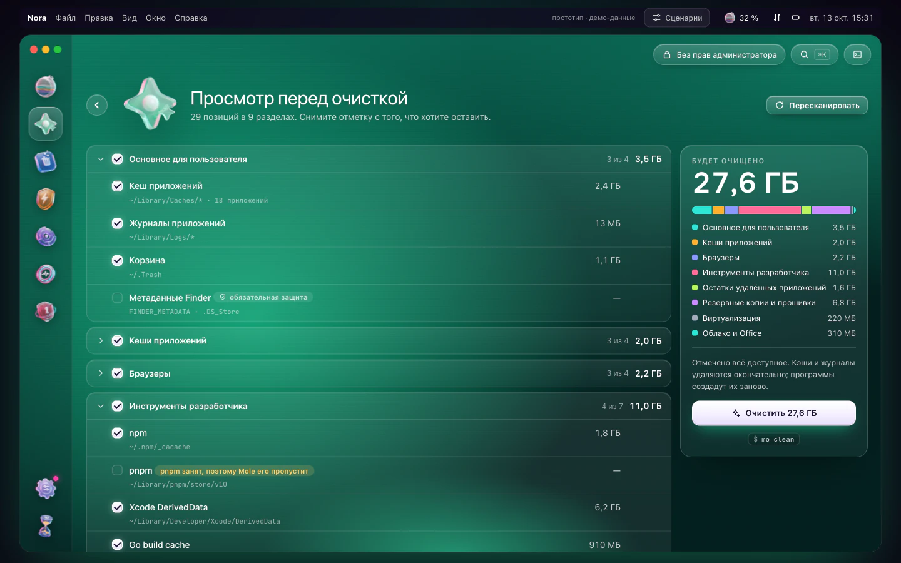
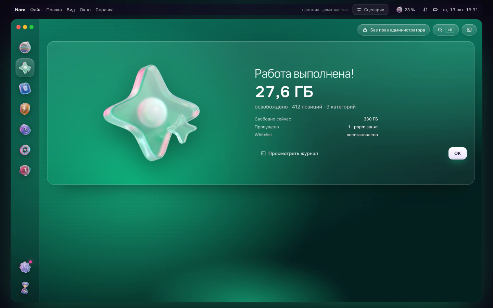
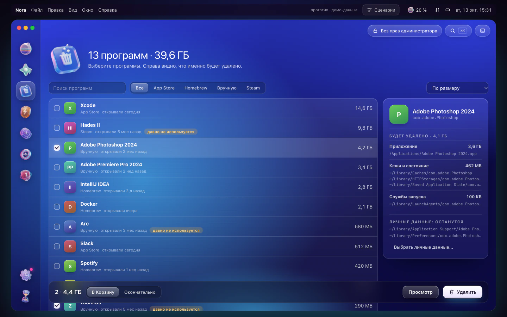
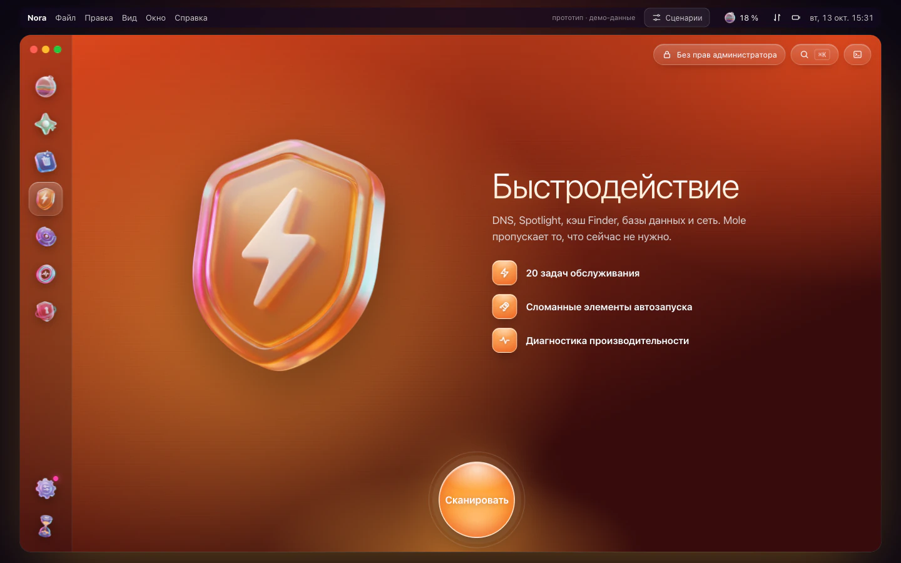
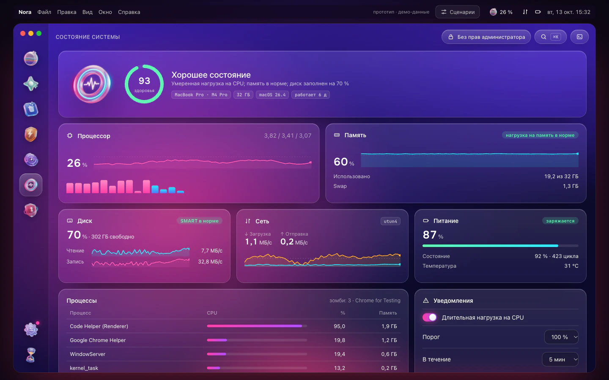
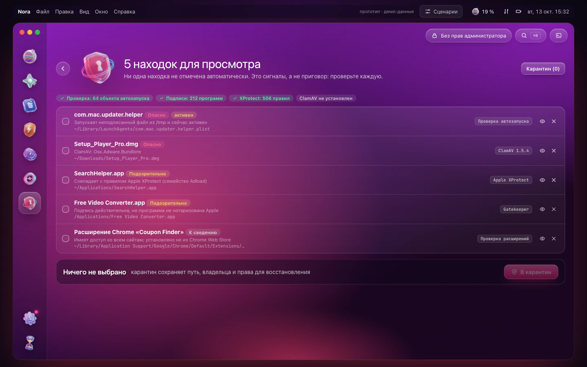
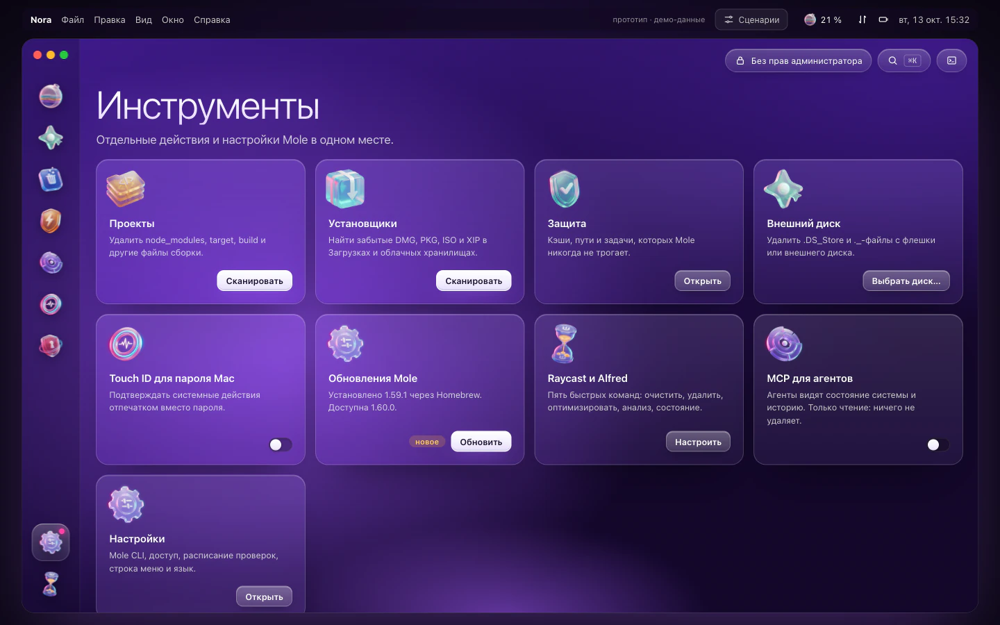

  

<h1 align="center">Nora</h1>

  <b>Понятное и честное приложение для macOS поверх <a href="https://github.com/tw93/Mole">Mole</a> CLI.</b> 
  Глубокая очистка · удаление программ · быстродействие · карта диска · состояние системы в реальном времени. Всё в одном окне и в строке меню.

  <a href="README.md">English</a> · <a href="README.uk.md">Українська</a> · <b>Русский</b>

  
  
  
  

  <a href="https://lexus2016.github.io/Nora/prototype/"><b>▶ Попробовать интерактивный прототип</b></a>

> [!NOTE]
> **Состояние проекта.** Нативное приложение на SwiftUI собрано, `scripts/build-dmg.sh` делает подписанный DMG, прошедший нотаризацию Apple. Первого публичного выпуска ещё нет. Он появится на странице [Releases](https://github.com/Lexus2016/Nora/releases). Нажмите *Watch*, чтобы не пропустить выпуск.
>
> Nora и прототип показывают английский, украинский или русский язык в зависимости от языка системы (браузера). Для любого другого языка показывается английский. Скриншоты ниже сделаны с утверждённого прототипа в браузере. Приложение сохраняет его дизайн, только вместо боковой панели с подписями в нём полоса иконок.

## Зачем Nora

[Mole](https://github.com/tw93/Mole) это открытый набор инструментов командной строки. Он объединяет возможности CleanMyMac, AppCleaner, DaisyDisk и iStat Menus. Nora даёт ему понятный нативный интерфейс и ничего не прячет.

- Сначала просмотр, потом удаление. Каждый модуль работает одинаково: *Сканировать → Просмотр → Готово*. Вы видите каждый путь и размер до того, как Mole что-либо сделает.
- Честные чекбоксы. Чекбокс появляется, только если Nora может заставить Mole выполнить это действие. Снятые пункты защищает временный whitelist Mole, который Nora потом возвращает. На запросы интерактивных меню Mole Nora отвечает только после того, как сверит список на экране с вашим выбором. Декоративных галочек нет.
- Ничего не спрятано. Каждое действие показывает точную команду `mo …`, а встроенная консоль показывает живой вывод Mole.
- Nora сама устанавливает и обновляет Mole. Достаточно одного нажатия, Терминал не нужен. Если на Mac есть Homebrew, Nora ставит Mole через него. Если Homebrew нет, Nora скачивает официальный установщик Mole нужной версии, проверяет контрольную сумму и кладёт Mole в `~/.local/bin`. Пароль администратора для этого не нужен. Сама Nora тоже обновляется (Sparkle 2, подписанный канал).
- Меню быстрого доступа в строке меню. Там показываются состояние системы, загрузка CPU, память, сеть, диск, графика, вентилятор, батарея, процессы с наибольшей нагрузкой и место, которое можно освободить. Оттуда же можно перейти в любой раздел одним нажатием.
- Нативная и лёгкая. Nora написана на SwiftUI и AppKit. Она управляет уже установленным Mole и не содержит собственного «движка».
- Язык выбирается сам. Английский, украинский или русский, в зависимости от языка macOS. Для остальных языков показывается английский.

## Возможности

| Модуль | Что делает | Команды Mole |
|---|---|---|
| **Умный уход** | Одна проверка без удаления: кэши, файлы сборки проектов (node_modules, target…), установщики, большие файлы. Затем одно безопасное действие «Запустить» | `mo clean --dry-run`, `mo purge --dry-run`, `mo installer --dry-run`, `mo analyze --json` |
| **Очистка** | Кэши, журналы, остатки удалённых программ, Корзина. По желанию системные кэши (Touch ID или пароль) | `mo clean` + оверлей whitelist, `sudo -A` в той же PTY-сессии |
| **Программы** | Удаление вместе с фоновыми помощниками (LaunchAgents), кэшами и настройками. Личные данные сохраняются. Программа уходит в Корзину или удаляется навсегда | `mo uninstall --list` (JSON), `mo uninstall [--permanent] "Программа"` |
| **Быстродействие** | 20 задач обслуживания (DNS, Spotlight, кэш Finder, базы данных, сеть…). Каждую задачу можно отключить | `mo optimize`, `~/.config/mole/whitelist_optimize` |
| **Анализ диска** | Кольца и плитки, открытие вложенных папок, подсказки (старые загрузки, резервные копии iOS, данные Xcode и Docker), большие файлы, внешние диски | `mo analyze --json PATH` |
| **Состояние системы** | Здоровье системы, загрузка CPU по ядрам, давление памяти, работа диска, сеть, батарея, температуры, Bluetooth, процессы, предупреждения о высокой нагрузке CPU | `mo status --watch --interval 1s` (NDJSON) |
| **Проекты** | `node_modules`, `target`, `build`, `.venv` и другие папки сборки по проектам. Недавно активные проекты не трогаются | `mo purge [--yes]` |
| **Установщики** | Забытые DMG, PKG, ISO, XIP и ZIP в Загрузках, iCloud, Почте, Telegram и Homebrew | `mo installer` |
| **История** | Панель активности: сколько места освобождено, сессии, рекомендации, полный журнал операций | `mo history --json` |
| **Защита** | То, что Mole никогда не должен трогать: правила кэшей, свои пути, отключённые задачи, папки для поиска проектов | `~/.config/mole/*` |
| **Инструменты** | Touch ID для sudo (вместо пароля администратора), очистка метаданных на внешних дисках, обновление Mole, автодополнение, Raycast и Alfred, MCP только на чтение для AI-агентов | `mo touchid`, `mo clean --external`, `mo update` |
| **Безопасность** *(запланировано)* | Проверка на вредоносное ПО по запросу: аудит автозапуска и фоновых помощников (LaunchAgents), проверка подписей и нотаризации, локальные правила YARA от Apple XProtect, движок ClamAV (ставится по запросу). Каждая находка объясняется, и ничего не отмечается автоматически. Файл из карантина можно восстановить | Security.framework, `yara`, `clamd` / `freshclam` |

## Скриншоты

| | |
|---|---|
|  |  |
| **Умный уход:** всё, что можно освободить | **Строка меню:** показатели в реальном времени и быстрые переходы |
|  |  |
| **Очистка:** стартовый экран | **Просмотр:** каждый путь, размер и правило защиты |
|  |  |
| **Готово:** сколько освобождено и журнал одним нажатием | **Программы:** что именно будет удалено |
|  |  |
| **Быстродействие:** задачи обслуживания | **Анализ диска:** плитки с отмеченными зонами очистки |
|  |  |
| **Состояние системы:** данные в реальном времени из потока NDJSON | **История:** панель активности |
|  |  |
| **Безопасность:** находки с объяснениями, без автоматических отметок | **Инструменты:** точечные действия и настройки |

## Как пользоваться

1. Откройте Nora. Если Mole на Mac нет, Nora предложит его установить. Терминал и пароль администратора для этого не нужны.
2. Выберите модуль на панели слева, или нажмите ⌘1…⌘8, или ⌘K для палитры команд.
3. Нажмите «Сканировать». На этом шаге ничего не удаляется: Nora запускает предварительный просмотр Mole.
4. Просмотрите список. Снимите отметку с того, что хотите оставить, или защитите пункт навсегда кнопкой со щитом.
5. Нажмите «Запустить». Nora покажет точную команду, попросит Touch ID только для системных зон и покажет результат. Кнопка «Посмотреть лог» открывает консоль с полным выводом Mole.

Значок Nora в строке меню (⌥⌘N) показывает показатели в реальном времени. Правая кнопка мыши открывает быстрые действия.

## Безопасность

- Nora никогда ничего не удаляет сама. Удаление происходит только после просмотра и явного подтверждения.
- Кэши и журналы (`mo clean`) и файлы сборки проектов (`mo purge`) удаляются безвозвратно. Mole перепроверяет каждый путь перед удалением. Установщики и удалённые программы уходят в Корзину. Перед безвозвратным удалением программы Nora переспрашивает ещё раз.
- 13 стандартных защит Mole (модели Ollama, кэши Gradle и JetBrains, браузеры Playwright, iCloud и другие), а также его обязательные правила сохраняются, когда Nora меняет whitelist.
- Права администратора запрашиваются системным окном или через Touch ID. Они действуют только в рамках одной сессии с командой Mole и нигде не сохраняются.
- Без телеметрии. Сеть используется только для проверки обновлений (Nora и Mole) и для загрузки установщика Mole. Всё это видно в консоли.

## Установка

> [!IMPORTANT]
> Первого выпуска ещё нет. Когда он выйдет, скачайте `Nora.dmg` на странице [Releases](https://github.com/Lexus2016/Nora/releases), откройте файл и перетащите **Nora** в папку **Программы**. Как собрать приложение самостоятельно, описано в [docs/BUILD.md](docs/BUILD.md) (на английском).

- macOS 14 Sonoma или новее, Apple silicon или Intel.
- [Mole](https://github.com/tw93/Mole) 1.55 или новее. Nora установит или обновит его сама.
- Рекомендуем дать полный доступ к диску, чтобы сканировались Почта, Safari и часть кэшей. Nora подскажет, как это сделать.

## Прототип

Утверждённый интерактивный прототип работает в любом современном браузере. Все данные в нём демонстрационные.

- Онлайн: **https://lexus2016.github.io/Nora/prototype/**
- Локально: `cd prototype && python3 -m http.server 8000`, затем откройте http://localhost:8000

Кнопка **«Сценарии»** вверху показывает состояния первого запуска, устаревшего Mole, отсутствия полного доступа к диску и сессии администратора.

## Документация

- **Дизайн и архитектура:** [English](docs/en/DESIGN.md) · [Українська](docs/uk/DESIGN.md) · [Русский](docs/ru/DESIGN.md). Полный перечень возможностей Mole, все референсы и то, что мы из них берём, матрица покрытия (механизм каждого чекбокса), архитектура, дизайн-система, этапы и риски.
- Сборка: [docs/BUILD.md](docs/BUILD.md) (на английском): требования, тесты, подпись, нотаризация и выпуск обновлений.
- Исходники иконки лежат в папке [`Design/AppIcon/`](Design/AppIcon/).

## План работ

- [x] Исследование: устройство Mole, четыре графические обёртки для Mole, более 20 открытых референсов
- [x] Утверждённый дизайн и интерактивный прототип
- [x] **M0** Спайк: PTY-драйвер, оверлей whitelist с восстановлением после сбоя, `sudo -A` в PTY. Проверено сквозными тестами на Mole 1.59.1 в [MoleKit](MoleKit).
- [x] **M1** Режим чтения: MoleKit, «Состояние системы» (NDJSON), «Анализ диска», «История», строка меню
- [x] **M2** Очистка: «Очистка», «Программы», «Проекты», «Установщики», «Быстродействие», «Защита»
- [x] **M3** Внешний вид: неоновая дизайн-система, реалистичные стеклянные 3D-ассеты, «Умный уход», онбординг, тексты на английском, украинском и русском
- [ ] **M4** Выпуск: подписанный DMG, прошедший нотаризацию Apple, обновления через Sparkle. *DMG собирается, проходит нотаризацию и получает печать Apple. Первого выпуска на GitHub и ленты обновлений ещё нет.*
- [ ] **M5** Модуль «Безопасность» (ClamAV, правила XProtect YARA и аудит автозапуска), проверки по расписанию, MCP только на чтение. *«Безопасность» и проверки по расписанию уже в приложении. MCP-сервера ещё нет.*

## Благодарности и товарные знаки

- **Mole** создан [tw93](https://github.com/tw93), лицензия GPL-3.0. *Mole* и логотип Mole являются товарными знаками проекта Mole. Nora является **независимым** проектом. Она не связана с Mole, не одобрена его авторами и не является официальным приложением [Mole for Mac](https://mole.fit).
- Референсы дизайна и исследования: [MangelSP/MoleUI](https://github.com/MangelSP/MoleUI), [Zhili1004/MoleUI](https://github.com/Zhili1004/MoleUI), [gokuscraper/mole-gui](https://github.com/gokuscraper/mole-gui), [caezium/Burrow](https://github.com/caezium/Burrow), [exelban/stats](https://github.com/exelban/stats) и другие. Полный список в дизайн-документе.

## Лицензия

[PolyForm Noncommercial 1.0.0](LICENSE) © 2026 Lexus2016

Код Nora можно использовать, копировать, изменять и распространять в любых некоммерческих целях: для себя, для учёбы, исследований и хобби-проектов, а также в благотворительных, образовательных и государственных организациях. Для коммерческого использования нужна отдельная лицензия от автора. Напишите ему в issue.

Mole является отдельным проектом под GPL-3.0. Nora запускает его как внешнюю программу и не содержит его кода, поэтому лицензия Mole не меняется.
