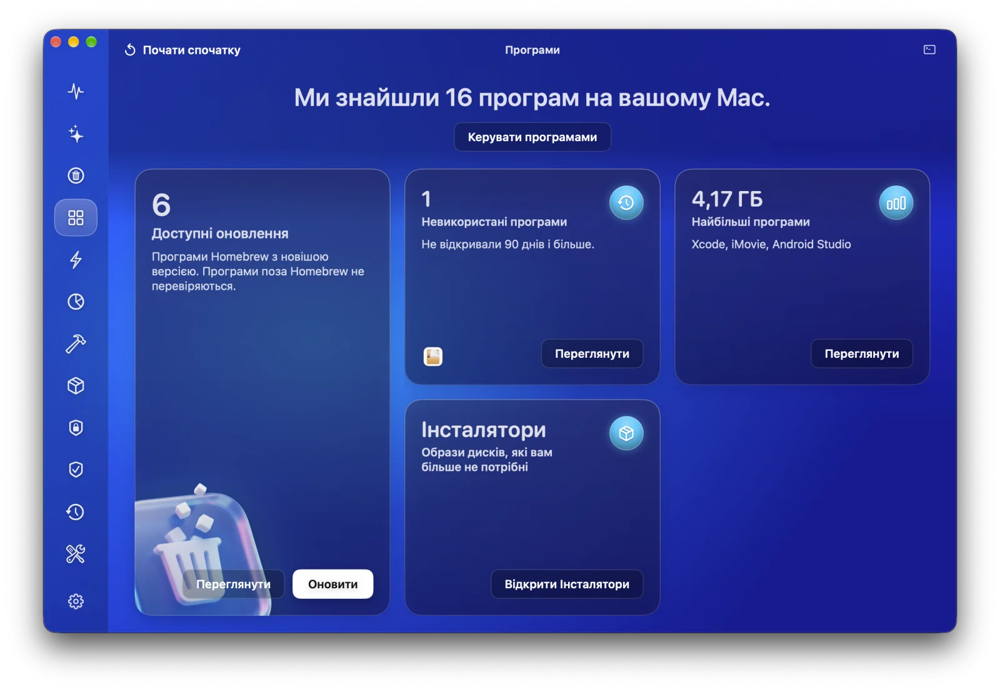
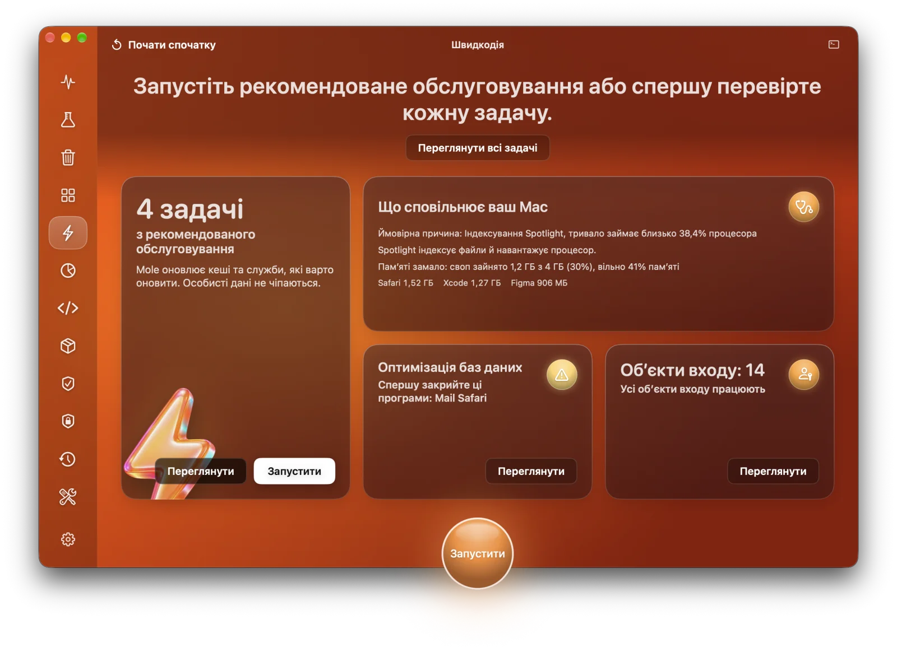
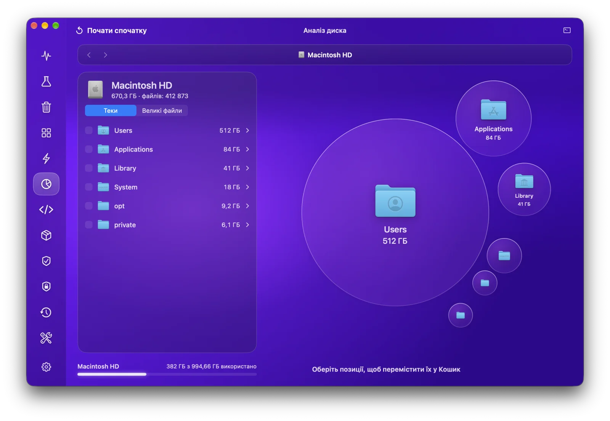
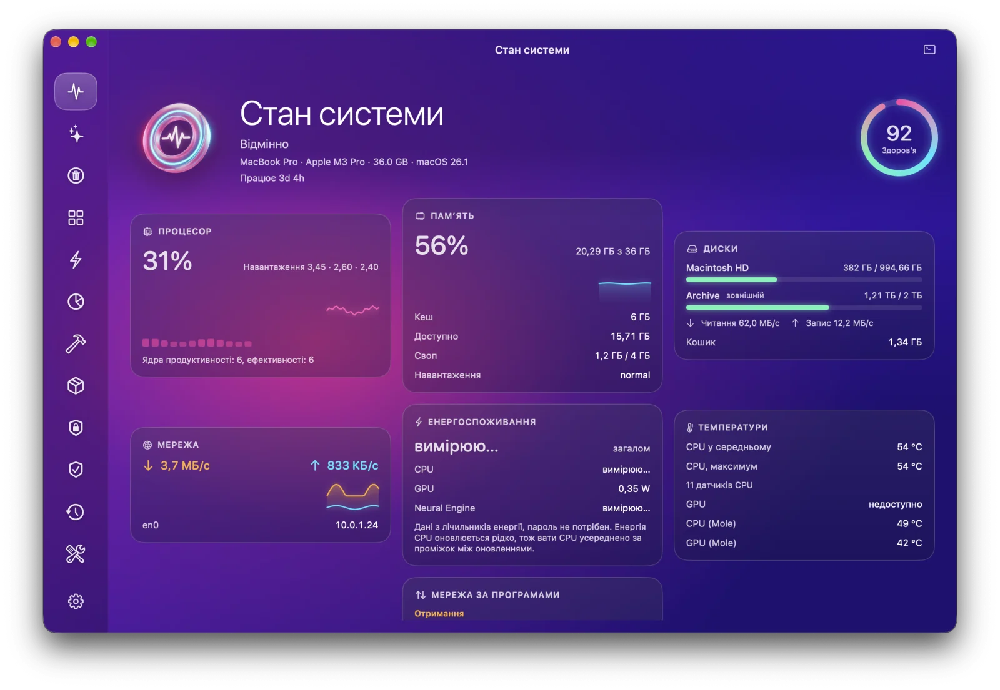
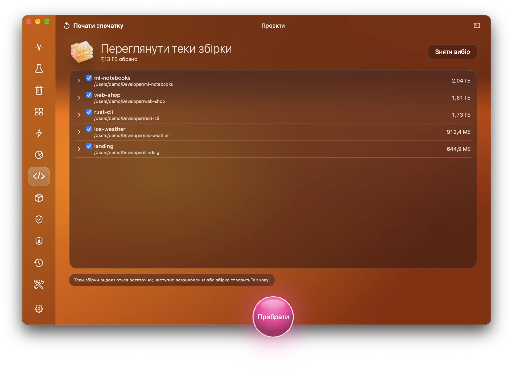
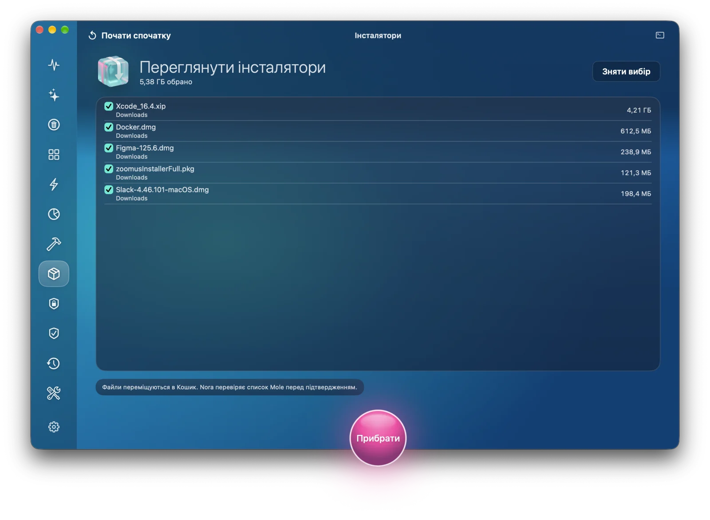
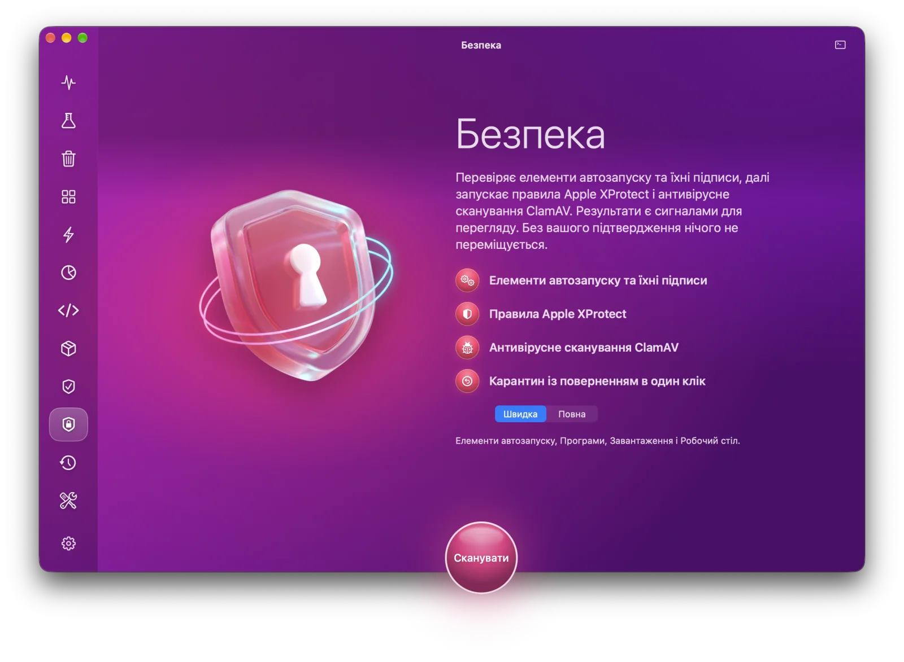
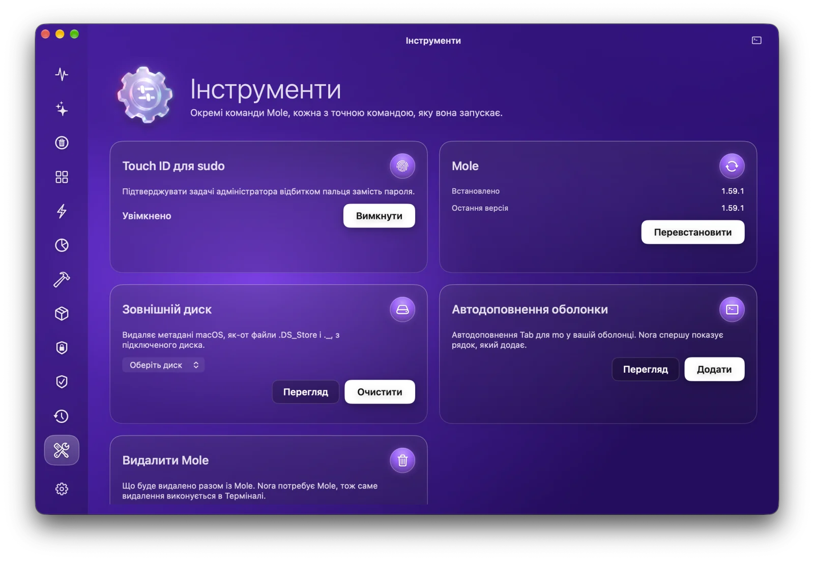

  

<h1 align="center">Nora</h1>

  <b>Нативний застосунок для macOS до інструмента командного рядка <a href="https://github.com/tw93/Mole">Mole</a>.</b> 
  Очищує Mac, видаляє програми разом із залишками, пришвидшує систему, показує, що займає диск, стежить за станом системи наживо й перевіряє на шкідливе ПЗ. Усе в одному скляному вікні та в меню-барі.

  <a href="README.md">English</a> · <b>Українська</b> · <a href="README.ru.md">Русский</a>

  
  
  
  

  <a href="https://github.com/Lexus2016/Nora/releases/latest"><b>⬇ Завантажити Nora для macOS</b></a>

## Навіщо Nora

[Mole](https://github.com/tw93/Mole) є безкоштовним відкритим набором інструментів. Він робить те саме, що CleanMyMac, AppCleaner, DaisyDisk та iStat Menus, але працює в Терміналі. Nora дає Mole нативне вікно для Mac і не приховує, що відбувається всередині.

- **Нічого не видаляється без вашого перегляду.** Кожен розділ працює однаково: Сканувати, Переглянути, Готово. Спершу ви бачите кожен елемент і його розмір.
- **Галочки, яким можна вірити.** Зняту галочку Nora справді дотримує: на час запуску вона захищає цей елемент і звіряє власний екран підтвердження Mole з вашим вибором. Якщо щось не збігається, Nora скасовує дію, і нічого не видаляється.
- **Нічого прихованого.** Консоль (<kbd>⌘J</kbd>) показує кожну команду, яку запустила Nora, і повний вивід Mole. У Налаштуваннях можна ввімкнути показ точної команди під кожною дією.
- **Сама встановлює Mole.** Термінал не потрібен. Якщо є Homebrew, Nora використає його. Якщо немає, запустить офіційний інсталятор Mole із закріпленою версією та перевіреною контрольною сумою. Пароль адміністратора не потрібен.
- **Швидке меню в меню-барі.** Стан системи, чотири показники на ваш вибір, що найбільше навантажує Mac, скільки місця можна звільнити, і перехід до будь-якого розділу (<kbd>⌥⌘N</kbd>).
- **Нативна й легка.** SwiftUI та AppKit, універсальний застосунок для Apple silicon та Intel. Nora запускає ваш Mole і не вбудовує власного рушія.
- **Багатомовна.** Nora говорить мовою вашого Mac, якщо знає її, інакше англійською. Нові мови вже в планах.

## Можливості

| Розділ | Що робить | Як працює |
|---|---|---|
| **Розумний догляд** | Одне сканування для сміття, обслуговування, тек збірки та інсталяторів. «Запустити» виконує всі позначені задачі по черзі | `mo clean`, `mo optimize`, `mo purge`, `mo installer` (спершу перегляд) |
| **Очищення** | Кеші, журнали й залишки за категоріями. Зніміть галочку, щоб залишити. Системні кеші за бажанням, з паролем або Touch ID | `mo clean` з тимчасовим списком захисту |
| **Програми** | Видаляє програму з її помічниками, кешами й налаштуваннями (у Кошик або остаточно), оновлює програми Homebrew, знаходить програми, які ви не відкриваєте, і найбільші | `mo uninstall`, `brew` |
| **Швидкодія** | Що сповільнює Mac просто зараз і 20 задач обслуговування (DNS, Spotlight, кеші Finder, бази даних, мережа) | `mo optimize` |
| **Аналіз диска** | Теки у вигляді бульбашок і списку, великі файли, перехід углиб і переміщення в Кошик | `mo analyze --json` |
| **Стан системи** | Оцінка стану, процесор, пам’ять, диски, мережа, енергія й температури, режим енергоспоживання, трафік за програмами, відкриті порти, батарея, Bluetooth | `mo status --watch`, системні лічильники |
| **Проєкти** | `node_modules`, `target`, `build`, `.venv` та інше, згруповано за проєктами. Нещодавно активні проєкти не чіпаються | `mo purge` |
| **Інсталятори** | Забуті DMG, PKG, ZIP та схожі файли в Завантаженнях, iCloud, Пошті й Telegram, у Кошик | `mo installer` |
| **Історія** | Звільнене місце, сесії та щоденний графік | `mo history --json` |
| **Захист** | Чого Mole ніколи не має чіпати: правила очищення, задачі обслуговування, теки проєктів | `~/.config/mole/*` |
| **Безпека** | Елементи автозапуску та їхні підписи, правила Apple XProtect і антивірусна перевірка ClamAV. Кожна знахідка пояснюється, і жодна не позначається заздалегідь. Карантин із поверненням одним кліком, перевірки за розкладом за бажанням | Security.framework, `yara`, ClamAV |
| **Інструменти** | Touch ID для sudo, очищення зовнішніх дисків, оновлення Mole, автодоповнення в оболонці | `mo touchid`, `mo clean --external`, `mo update` |

## Скриншоти

| | |
|---|---|
|  |  |
| **Розумний догляд:** одне сканування для всього | **Меню-бар:** показники наживо й швидкі переходи |
|  |  |
| **Очищення:** сміття за категоріями, перегляд перед очищенням | **Програми:** оновлення, невживані й найбільші програми |
|  |  |
| **Швидкодія:** що сповільнює Mac і що запустити | **Аналіз диска:** що займає місце |
|  |  |
| **Стан системи:** наживо, щосекунди | **Проєкти:** теки збірки за проєктами |
|  |  |
| **Інсталятори:** забуті образи дисків | **Історія:** що зробив Mole |
|  |  |
| **Безпека:** сигнали для перегляду, без вашого кліку нічого не переміщується | **Інструменти:** менші команди Mole |

На скриншотах демонстраційні дані.

## Встановлення

1. Завантажте `Nora-1.0.0.dmg` з [останнього випуску](https://github.com/Lexus2016/Nora/releases/latest).
2. Відкрийте його й перетягніть **Nora** у **Програми**.
3. Запустіть Nora. Якщо Mole немає, Nora встановить його сама.

- macOS 14 Sonoma або новіша, Apple silicon або Intel.
- Застосунок підписаний Developer ID і нотаризований Apple, тож відкривається без попереджень.
- Nora оновлюється сама через Sparkle, а Mole оновлюється з розділу «Інструменти».
- Радимо надати повний доступ до диска, щоб сканувалися Пошта, Safari й Кошик. Nora підкаже, де його ввімкнути.

Як зібрати Nora самостійно, описано в [docs/BUILD.md](docs/BUILD.md).

## Як користуватися

1. Оберіть розділ на бічній панелі. Найшвидше почати з **Розумного догляду**.
2. Натисніть **Сканувати**. На цьому кроці нічого не видаляється: Nora запускає перегляд Mole.
3. Перегляньте список. Зніміть галочки з того, що хочете залишити, або захистіть назавжди в розділі **Захист**.
4. Натисніть круглу кнопку, щоб запустити. Пароль Nora питає лише тоді, коли включено системні області, а потім показує, що зроблено. **Показати журнал** відкриває повний вивід Mole.

## Безпечність

- Nora ніколи не видаляє нічого сама. Видалення завжди йде після перегляду й вашого кліку.
- Кеші, журнали й теки збірки видаляються остаточно, як і в Mole; перед цим Mole ще раз перевіряє кожен шлях. Програми та інсталятори йдуть у Кошик. Остаточне видалення програми Nora перепитує.
- Коли Nora змінює список захисту Mole, власні захисти Mole за замовчуванням і правила безпеки лишаються на місці.
- Пароль іде напряму до `sudo` через системне вікно або Touch ID. Nora його не бачить і не зберігає.
- Жодної телеметрії. Nora виходить в інтернет лише щоб перевірити оновлення (Nora й Mole), встановити Mole й оновити базу ClamAV, якщо ви встановили ClamAV.

Відомі обмеження, бо так працює Mole: теки збірки Mole видаляє через повторне сканування, а не за списком, тож тека, що з’явилася за кілька секунд до видалення, не захищена; інсталятори розпізнаються за назвою, текою й розміром, бо меню Mole не показує повного шляху.

## Документація

- **Дизайн і архітектура:** [English](docs/en/DESIGN.md) · [Українська](docs/uk/DESIGN.md) · [Русский](docs/ru/DESIGN.md)
- **Збирання й випуск:** [docs/BUILD.md](docs/BUILD.md)
- **Ранній концепт дизайну:** [інтерактивний браузерний прототип](https://lexus2016.github.io/Nora/prototype/), з якого виріс застосунок

## План розвитку

- [x] Дослідження, дизайн та інтерактивний прототип
- [x] Драйвер Mole: сесії псевдотерміналу, накладка захисту з відновленням після збою, `sudo` в тій самій сесії ([MoleKit](MoleKit))
- [x] Усі розділи Mole, Розумний догляд, меню-бар, перший запуск, багатомовний інтерфейс
- [x] Безпека: автозапуск, правила XProtect, ClamAV, карантин, перевірки за розкладом
- [x] 1.0: підписаний і нотаризований DMG, оновлення через Sparkle
- [ ] MCP-сервер лише для читання для ШІ-агентів
- [ ] Нові мови

## Подяки й торговельні марки

- **Mole** створив [tw93](https://github.com/tw93), ліцензія GPL-3.0. *Mole* і логотип Mole є торговельними марками проєкту Mole. Nora є **незалежним** проєктом. Він не пов’язаний з Mole і не схвалений ним, і це не офіційний застосунок [Mole for Mac](https://mole.fit).
- Референси для дизайну й досліджень: [MangelSP/MoleUI](https://github.com/MangelSP/MoleUI), [Zhili1004/MoleUI](https://github.com/Zhili1004/MoleUI), [gokuscraper/mole-gui](https://github.com/gokuscraper/mole-gui), [caezium/Burrow](https://github.com/caezium/Burrow), [exelban/stats](https://github.com/exelban/stats) та інші, перелічені в документі дизайну.

## Ліцензія

[PolyForm Noncommercial 1.0.0](LICENSE) © 2026 Lexus2016

Код Nora можна використовувати, копіювати, змінювати й поширювати з будь-якою некомерційною метою: для себе, для навчання, досліджень і хобі-проєктів, а також благодійним організаціям, школам і державним установам. Для комерційного використання потрібна окрема ліцензія від автора. Відкрийте issue, щоб запитати.

Mole є окремим проєктом під GPL-3.0. Nora запускає його як зовнішню програму й не містить його коду, тож ліцензія Mole не зачіпається.
