

  

<h1 align="center">Nora</h1>

  <b>Застосунок для macOS, який працює поверх інструмента командного рядка <a href="https://github.com/tw93/Mole">Mole</a>.</b> 
  Глибоке очищення · видалення програм · швидкодія · карта диска · стан системи у реальному часі. Усе в одному вікні з неоновим оформленням і в рядку меню.

  <a href="README.md">English</a> · <b>Українська</b> · <a href="README.ru.md">Русский</a>

  
  
  
  

  <a href="https://lexus2016.github.io/Nora/prototype/"><b>▶ Спробувати інтерактивний прототип</b></a>

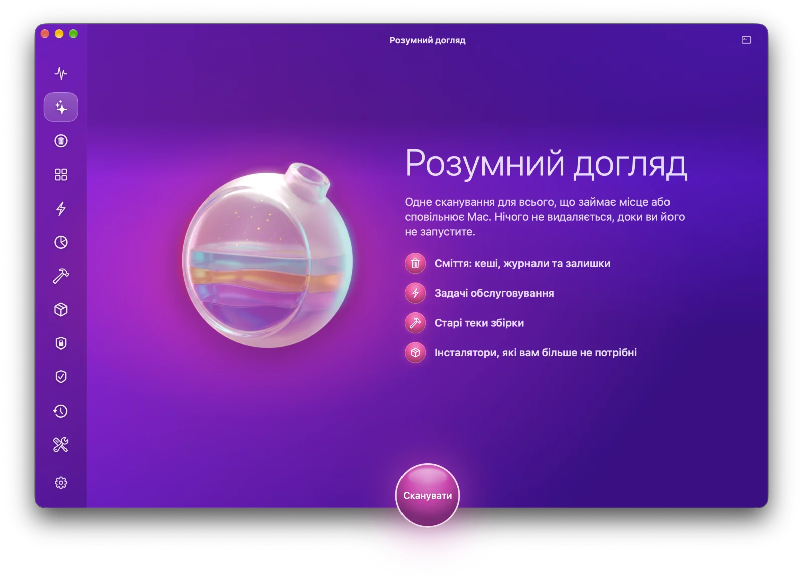

> [!NOTE]
> Стан проєкту: дизайн і інтерактивний прототип затверджено, нативний застосунок на SwiftUI ще в розробці. Підписані DMG-файли з’являтимуться на сторінці [Releases](https://github.com/Lexus2016/Nora/releases). Щоб не пропустити вихід, натисніть *Watch*.

## Навіщо Nora

[Mole](https://github.com/tw93/Mole) є відкритим інструментом командного рядка. Він поєднує можливості CleanMyMac, AppCleaner, DaisyDisk та iStat Menus, але без вікна. Nora дає Mole звичайний інтерфейс macOS і нічого від вас не ховає.

- Спершу перегляд, потім видалення. Кожен модуль працює однаково: Сканувати → Перегляд → Готово. Ви бачите кожен шлях і розмір до того, як Mole щось зробить.
- Прапорці з’являються лише там, де Nora справді може змусити Mole виконати дію. Зняті позиції захищає тимчасовий список захисту Mole (whitelist), який Nora потім повертає. Коли Mole у своєму інтерактивному меню ставить запитання, Nora відповідає лише після того, як звірить список на екрані з вашим вибором. Жодних декоративних прапорців.
- Кожна дія показує точну команду `mo …`. Вбудована консоль показує вивід Mole у реальному часі.
- Nora сама встановлює та оновлює Mole. Це один клік без Терміналу. Якщо є Homebrew, Nora встановлює Mole через нього. Інакше вона запускає офіційний інсталятор закріпленої версії Mole. Перед запуском перевіряється контрольна сума, Mole встановлюється в `~/.local/bin`, пароль адміністратора не потрібен. Nora також оновлюється сама через Sparkle 2 з підписаного каналу.
- Швидкий доступ із рядка меню. Тут видно стан системи, навантаження CPU, пам’ять, мережу, диск, графіку, вентилятор, батарею, найактивніші процеси та місце, яке можна звільнити. Звідси можна перейти в будь-який розділ одним кліком.
- Nora написана на SwiftUI та AppKit і керує Mole, який уже встановлено на вашому Mac. Власного рушія вона не має.
- Nora і прототип показують англійську, українську або російську залежно від мови системи (браузера). Для будь-якої іншої мови показується англійська. Окремого перемикача мови немає.

## Можливості

| Модуль | Що робить | Команди Mole |
|---|---|---|
| Розумний догляд | Одна перевірка без видалення: кеші, файли збірки проєктів, інсталятори, великі файли. Потім одна безпечна дія «Запустити» | `mo clean --dry-run`, `mo purge --dry-run`, `mo installer --dry-run`, `mo analyze --json` |
| Очищення | Кеші, журнали, залишки видалених програм і Кошик. За бажанням також системні кеші, з підтвердженням через Touch ID або пароль | `mo clean` + оверлей whitelist, `sudo -A` у тій самій PTY-сесії |
| Програми | Видалення разом із фоновими помічниками (LaunchAgents), кешами й налаштуваннями. Особисті дані лишаються. Програму можна перенести в Кошик або видалити остаточно | `mo uninstall --list` (JSON), `mo uninstall [--permanent] "Програма"` |
| Швидкодія | 20 задач обслуговування (DNS, Spotlight, кеш Finder, бази даних, мережа…). Кожну можна вимкнути | `mo optimize`, `~/.config/mole/whitelist_optimize` |
| Аналіз диска | Кільця та плитки, перехід у вкладені папки, підказки (старі завантаження, резервні копії iOS, дані Xcode і Docker), великі файли, зовнішні диски | `mo analyze --json PATH` |
| Стан системи | Стан здоров’я, навантаження CPU по ядрах, тиск пам’яті, читання та запис на диск, мережа, батарея, температури, Bluetooth, процеси, сповіщення про навантаження CPU | `mo status --watch --interval 1s` (NDJSON) |
| Проєкти | `node_modules`, `target`, `build`, `.venv` тощо за проєктами. Нещодавно активні проєкти не чіпаються | `mo purge [--yes]` |
| Інсталятори | Забуті DMG, PKG, ISO, XIP і ZIP-файли у Завантаженнях, iCloud, Пошті, Telegram, Homebrew | `mo installer` |
| Історія | Панель активності: звільнене місце, сесії, рекомендації, повний журнал операцій | `mo history --json` |
| Захист | Те, чого Mole не має чіпати ніколи: правила кешів, власні шляхи, вимкнені задачі, теки пошуку проєктів | `~/.config/mole/*` |
| Інструменти | Touch ID для sudo, очищення метаданих на зовнішніх дисках, оновлення Mole, автодоповнення, Raycast і Alfred, MCP лише для читання для ШІ-агентів | `mo touchid`, `mo clean --external`, `mo update` |
| Безпека *(заплановано)* | Перевірка на шкідливе ПЗ за запитом: аудит автозапуску та LaunchAgents, перевірка підписів і нотаризації, локальні правила YARA від Apple XProtect, рушій ClamAV (встановлюється за запитом). Кожна знахідка пояснюється, і жодна не позначається автоматично. Файл із карантину можна відновити | Security.framework, `yara`, `clamd` / `freshclam` |

## Скриншоти

| | |
|---|---|
| 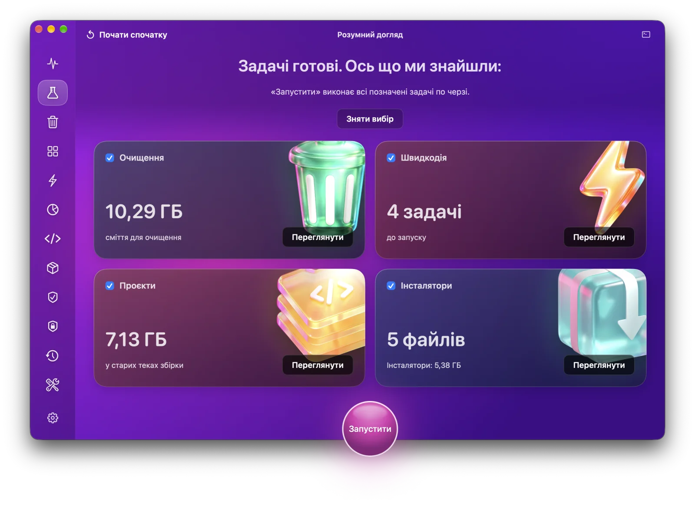 | 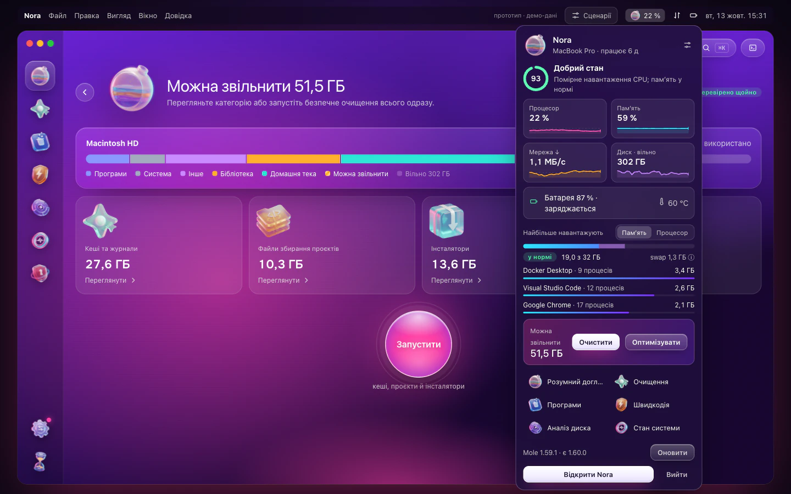 |
| Розумний догляд: усе, що можна звільнити | Рядок меню: живі показники та швидкі переходи |
| 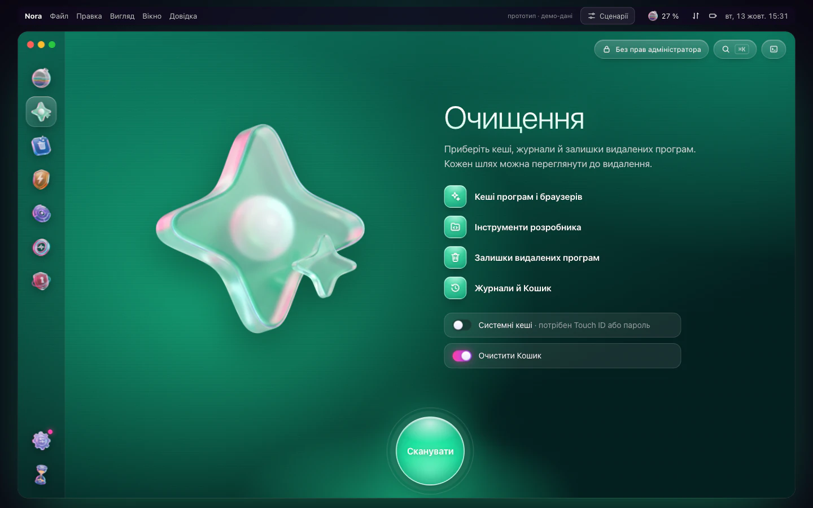 | 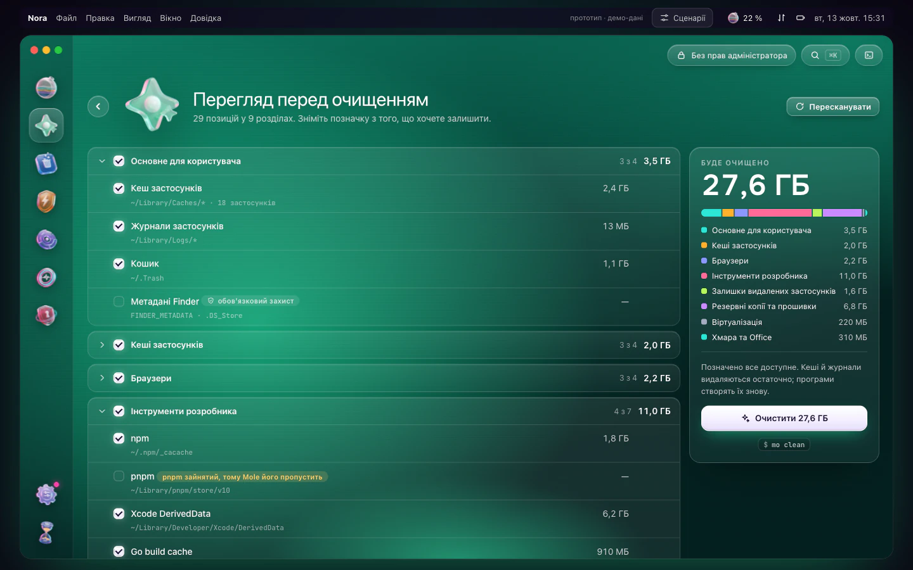 |
| Очищення: стартовий екран | Перегляд: кожен шлях, розмір і правило захисту |
| 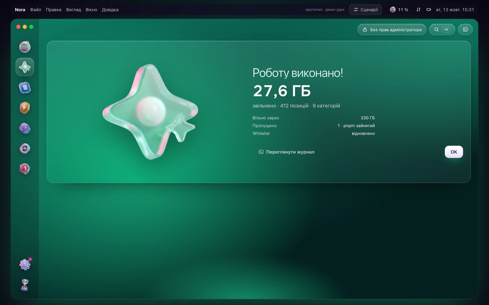 | 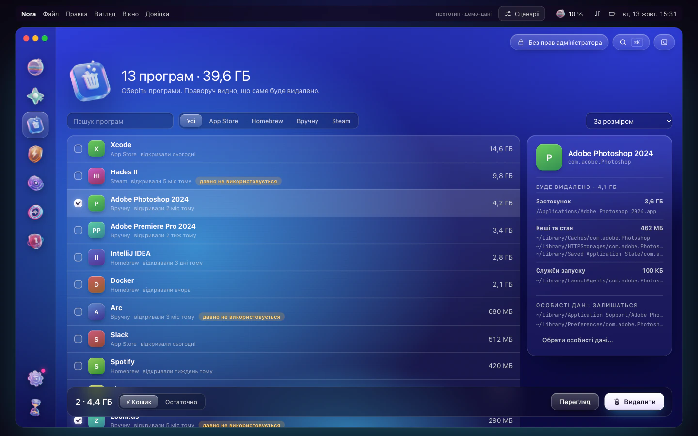 |
| Готово: скільки звільнено, журнал одним кліком | Програми: що саме буде видалено |
| 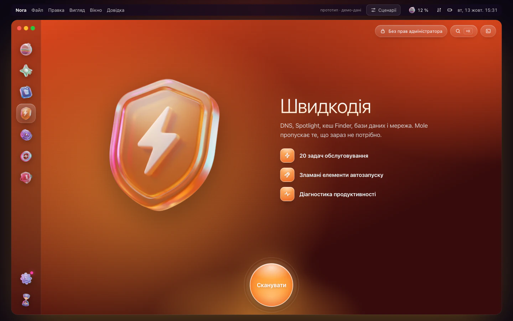 | 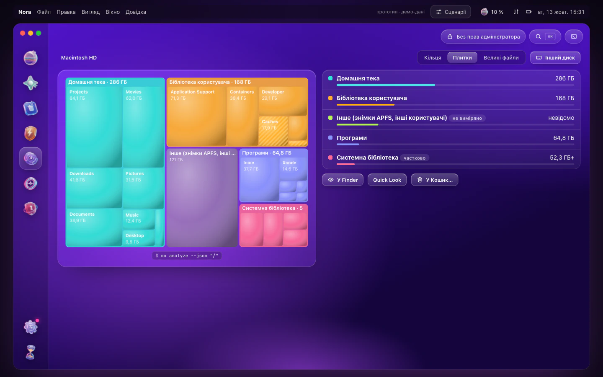 |
| Швидкодія: задачі обслуговування | Аналіз диска: плитки з позначеними зонами очищення |
| 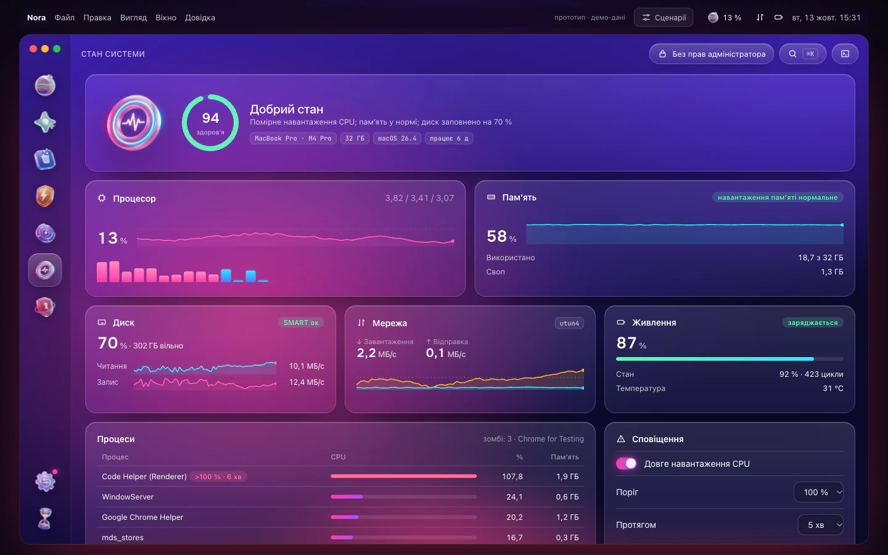 | 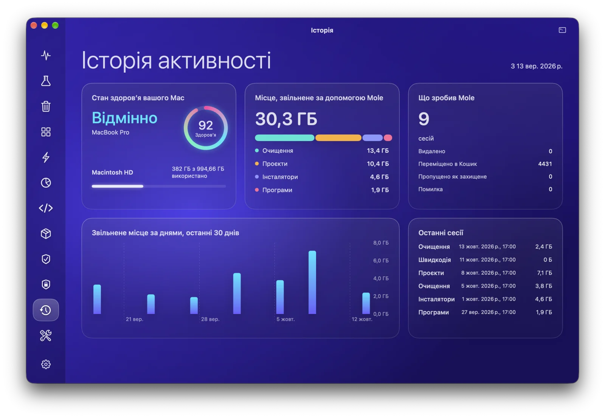 |
| Стан системи: у реальному часі з потоку NDJSON | Історія: панель активності |
| 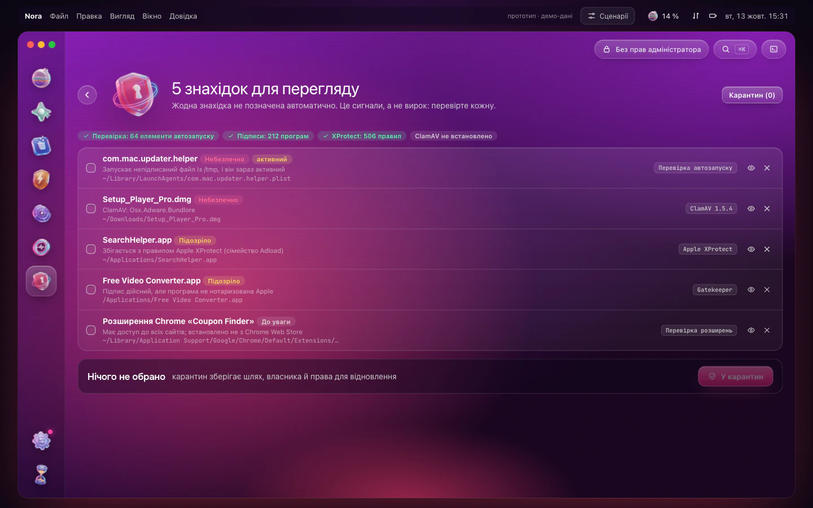 | 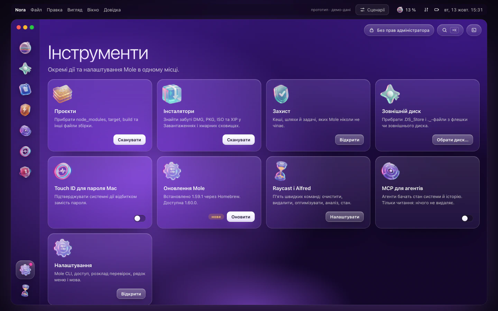 |
| Безпека: пояснені знахідки без автоматичних позначок | Інструменти: точкові дії та налаштування |

## Як користуватися

1. Відкрийте Nora. Якщо Mole немає, Nora запропонує його встановити. Термінал і пароль адміністратора для цього не потрібні.
2. Оберіть модуль на бічній панелі ліворуч (або ⌘1…⌘8, або ⌘K для пошуку команд).
3. Натисніть «Сканувати». На цьому кроці нічого не видаляється: Nora запускає попередній перегляд Mole.
4. Перегляньте список. Приберіть прапорець з того, що хочете залишити, або захистіть елемент назавжди кнопкою зі щитом.
5. Запустіть. Nora покаже точну команду, попросить Touch ID лише для системних зон і покаже результат. Кнопка «Переглянути журнал» відкриває консоль із повним виводом Mole.

Піктограма в рядку меню (⌥⌘N) показує живі показники. Права кнопка відкриває швидкі дії.

## Безпека

- Nora ніколи сама нічого не видаляє. Видалення відбувається лише після перегляду та явного підтвердження.
- Кеші й журнали (`mo clean`) та файли збірки проєктів (`mo purge`) видаляються остаточно. Mole перевіряє кожен шлях ще раз перед видаленням. Програми за замовчуванням переносяться в Кошик.
- 13 типових захистів Mole (моделі Ollama, кеші Gradle і JetBrains, браузери Playwright, iCloud тощо) та його обов’язкові правила зберігаються, коли Nora змінює список захисту.
- Права адміністратора запитуються через системне вікно або Touch ID. Вони діють лише в межах однієї сесії з командою Mole і ніколи не зберігаються.
- Без телеметрії. Мережа потрібна лише для перевірки оновлень Nora і Mole та для завантаження інсталятора Mole. Усе це видно в консолі.

## Встановлення

> [!IMPORTANT]
> Застосунок ще не випущено. Коли вийде, завантажте `Nora.dmg` зі сторінки [Releases](https://github.com/Lexus2016/Nora/releases), відкрийте його та перетягніть Nora у папку Програми.

- macOS 14 Sonoma або новіша, Apple silicon або Intel.
- [Mole](https://github.com/tw93/Mole) 1.55 або новіший. Nora встановить або оновить його сама.
- Рекомендовано надати повний доступ до диска, щоб сканувалися Пошта, Safari й частина кешів. Nora підкаже, як це зробити.

## Прототип

Затверджений інтерактивний прототип працює в будь-якому сучасному браузері. Усі дані в ньому демонстраційні.

- Онлайн: https://lexus2016.github.io/Nora/prototype/
- Локально: `cd prototype && python3 -m http.server 8000`, потім відкрийте http://localhost:8000

Кнопка «Сценарії» вгорі показує стани першого запуску, застарілого Mole, відсутнього повного доступу до диска та сесії адміністратора.

## Документація

- Дизайн і архітектура: [English](docs/en/DESIGN.md) · [Українська](docs/uk/DESIGN.md) · [Русский](docs/ru/DESIGN.md). Тут повний перелік можливостей Mole, усі референси та те, що ми з них беремо, матриця покриття з механізмом кожного прапорця, архітектура, дизайн-система, етапи й ризики.
- Вихідні файли іконки: [`Design/AppIcon/`](Design/AppIcon/)

## План робіт

- [x] Дослідження: внутрішня будова Mole, 4 GUI-обгортки, понад 20 відкритих референсів
- [x] Затверджений дизайн та інтерактивний прототип
- [ ] **M0** Пробна реалізація: PTY-драйвер, whitelist-оверлей із відновленням після збою, `sudo -A` у PTY. *У роботі: ядро PTY у [MoleKit](MoleKit), драйвери інсталяторів і видалення програм та whitelist-оверлей проходять наскрізні тести на Mole 1.59.1, `sudo -A` у PTY підтверджено; далі: драйвер purge.*
- [ ] **M1** Режим читання: MoleKit, Стан системи (NDJSON), Аналіз диска, Історія, рядок меню
- [ ] **M2** Очищення: Очищення, Програми, Проєкти, Інсталятори, Швидкодія, Захист
- [ ] **M3** Вигляд: неонова дизайн-система, реалістичні скляні 3D-асети, Розумний догляд, онбординг, тексти EN/UK/RU
- [ ] **M4** Випуск: підписаний і нотаризований DMG, оновлення через Sparkle
- [ ] **M5** Модуль «Безпека» (ClamAV + XProtect YARA + аудит автозапуску), перевірки за розкладом, MCP лише для читання

## Подяки й торговельні марки

- Mole створив [tw93](https://github.com/tw93) і поширює його за ліцензією GPL-3.0. *Mole* та логотип Mole є торговельними марками проєкту Mole. Nora є незалежним проєктом. Вона не пов’язана з Mole, не схвалена ним і не є офіційним застосунком [Mole for Mac](https://mole.fit).
- Джерела для дизайну й дослідження: [MangelSP/MoleUI](https://github.com/MangelSP/MoleUI), [Zhili1004/MoleUI](https://github.com/Zhili1004/MoleUI), [gokuscraper/mole-gui](https://github.com/gokuscraper/mole-gui), [caezium/Burrow](https://github.com/caezium/Burrow), [exelban/stats](https://github.com/exelban/stats) та інші. Повний перелік є в дизайн-документі.

## Ліцензія

[PolyForm Noncommercial 1.0.0](LICENSE) © 2026 Lexus2016

Код Nora можна використовувати, копіювати, змінювати й поширювати в будь-яких некомерційних цілях: для себе, для навчання, досліджень і хобі-проєктів, а також у благодійних, освітніх і державних установах. Для комерційного використання потрібна окрема ліцензія від автора. Напишіть йому через issue.

Mole є окремим проєктом під ліцензією GPL-3.0. Nora запускає його як зовнішню програму й не містить його коду, тому ліцензія Mole не змінюється.
